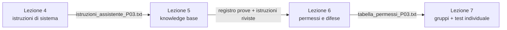

# Bozza del percorso · lezioni 4–7 con Unsloth Studio in locale

Documento riservato al docente. **Bozza da approvare**: non sono ancora materiali per gli studenti e nessuna attività è stata provata sulle VM della scuola. Le risorse vengono da `RICERCA_ATTIVITA_ONLINE.md`, dove sono indicati esiti della validazione, termini d'uso e fonti.

## Struttura

| Incontro | Data | Durata | Contenuto |
| --- | --- | --- | --- |
| Lezione 4 | 12 novembre 2026 | 2 ore | Reti neurali nel browser e agente Copilot con più competenze |
| Lezione 5 | 18 novembre 2026 | 2 ore | Documenti e recupero (RAG) |
| Lezione 6 | 25 novembre 2026 | 2 ore | Agenti, permessi e difese |
| Lezione 7 | 2 dicembre 2026 | 4 ore | Lavoro di gruppo e test finale individuale |

## Vincoli

- **VM della scuola: al massimo 8 GB di RAM, nessuna GPU.** Unsloth Studio dichiara il funzionamento su sola CPU ([Chat](https://unsloth.ai/docs/new/studio/chat)); memoria e tempi sulla VM sono da misurare.
  - Un solo modello GGUF piccolo e quantizzato, già presente nella VM che il docente consegna alla lezione 5.
  - Niente Model Arena (carica due modelli), addestramento, esportazioni o conversioni.
  - RAG in modalità BM25, già indicata in `materiali_aula/RISORSE_E_ACCESSO.md` §3.1.
- **Siti esterni dal browser del PC fisico, solo quelli che elaborano nel browser** (decisione del 5 novembre 2026). Nella lezione 3 Copilot non ha risposto a nessuno per circa 10 minuti: ipotesi, limite di richieste dallo stesso indirizzo pubblico in uscita, non verificata. Restano nel percorso solo siti statici o che calcolano nel browser; sono esclusi HackMerlin, Prompt Airlines e Gandalf, che interrogano un modello sul server. Il controllo dei siti è nella tabella «Siti esterni» più sotto. Unsloth Studio gira nella VM e non usa la rete. Restano esclusi anche gli strumenti che richiedono WebGPU (WebLLM, Qwen3 Embedding Scatterplot) finché non si conoscono le schede grafiche dei PC fisici.
- **La VM con Studio si prepara a casa e si consegna alla lezione 5** (decisione del 10 novembre 2026, che sostituisce quella del 5 novembre). Il docente copia una VM dai PC della scuola su un HDD, a casa installa Studio e il modello, e la redistribuisce il 18 novembre. La lezione 4 non usa Studio, e nessuna parte della lezione 4 dipende dalla VM. Le misure sulla VM, i parametri e la prova delle istruzioni nel System Prompt passano alla lezione 5. Quello che resta valido della vecchia lezione 4 con Studio è in `docente/backup/da_riprendere_lezione_5/NOTE_STUDIO_PER_LEZIONE_5.md`.
- **Lezione 3 svolta il 4 novembre 2026** (resoconto del docente del 5 novembre). Svolti: agenti con Python creati dagli studenti; Prova A e Prova B «più o meno»; confronto dell'output dell'agente con e senza la scheda di passaggio (`.handoff`), sul file `.xlsx`; limiti e potenzialità del RAG. Il blocco di Copilot ha rallentato i lavori, ma il materiale non copriva comunque le 2 ore: finito a 1 h 40 min. La stima del revisore (circa 141 minuti) era quindi troppo alta; per la lezione 4 si può progettare una lezione più piena. I materiali per gli studenti non citano tempi.
- Regole del progetto: gli studenti scrivono e correggono le proprie istruzioni; i casi di prova li inventano loro; nessuna attività si basa sull'errore atteso del modello; le istruzioni di esempio si pubblicano dopo il tentativo, in una cartella separata; nessun tempo di completamento nei materiali.
- **Niente consegna di file, verifica a voce, nessun voto nelle lezioni intermedie** (decisione del 6 novembre 2026). Con 22 studenti, PC lenti e Teams lento caricare i file non è praticabile. Il voto sarà assegnato solo al lavoro di gruppo della lezione 7 e al test finale, che richiede consegne di file. Le consegne indicate più sotto per le lezioni 5 e 6 sono da riprogettare in appunti personali con verifica a voce quando si progettano quelle lezioni. Scopo delle lezioni intermedie: far vedere che cosa si può fare con lo strumento.

## Filo conduttore

Ogni lezione riparte dall'assistente costruito nella precedente: il testo delle istruzioni è nel file `istruzioni_assistente_P03.txt` degli appunti personali di ogni studente. Nella lezione 4 è il testo dell'agente di Microsoft Copilot; dalla lezione 5 si può incollare anche nel campo System Prompt di Studio, se la VM resta uguale da una lezione all'altra (controllo da fare nella lezione 5). Nella lezione 7 il gruppo lo estende a un documento nuovo e lo fa collaudare da un altro gruppo.

## Lezione 4 · Un agente che sa fare più cose

**Materiali pronti:** `Lezione4_Reti_neurali_e_agenti_con_orchestrazione_ITS_MAKER.pptx`, `studenti/ATTIVITA_LEZIONE4.docx`, `docente/GUIDA_DOCENTE.docx`. Fa fede la guida docente: questa sezione riassume le scelte.

Obiettivo: capire, giocando, come impara un programma di intelligenza artificiale e progettare un agente di Microsoft Copilot con più competenze.

**Decisioni del 10 novembre 2026: senza Unsloth Studio, lavoro singolo, nessun giro di controllo tra i banchi.** Restano la P03 e la dimostrazione del docente sul noleggio di biciclette. La revisione sviluppata con Claude Fable sostituisce i registri da compilare con sfide a risultato visibile e un agente costruito per tappe. Il docente ha scelto Copilot e proiettore, senza un nuovo cruscotto: le richieste si mostrano prima, i criteri dopo la prova. Nessuno controlla il lavoro di un compagno.

Parti, come nella consegna degli studenti:

1. **Cambiate le probabilità** · [Transformer Explainer](https://poloclub.github.io/transformer-explainer/) (MIT): sul primo esempio, portare la barra più lunga sopra 90% e sotto 30% con Temperature. Previsione a mano alzata, nessun appunto.
2. **Quanti neuroni servono?** · [TensorFlow Playground](https://playground.tensorflow.org/) (Apache-2.0): sul cerchio, da zero neuroni nascosti in su, con Test loss sotto 0,05 entro 1.500 giri. Previsione a mano alzata, poi i disegni dentro i neuroni (ogni neurone separa i colori con una linea) e il peso di una linea prima e dopo l'addestramento. Poi la spirale, senza obbligo di riuscire. Confronto Training loss/Test loss sul disturbo al proiettore, senza promettere un peggioramento. Decisione dell'11 novembre 2026.
3. **Un esempio dal proiettore** · [Flappy Learning](https://xviniette.github.io/FlappyLearning/) (MIT): dimostrazione del docente di un paio di minuti, senza previsioni né consegna per gli studenti. Si copiano le reti migliori con modifiche a caso: anche lì cambiano i pesi, ma nessuno li corregge guardando un errore. Decisione dell'11 novembre 2026: il docente ha giudicato le attività su Flappy poco profonde.
4. **Costruite e collaudate l'agente P03** · Dimostrazione biciclette; prima competenza FERMO e subito due richieste dal reparto; seconda competenza ALLARMI o PASSAGGIO, indice e due esempi propri di stile. Due casi critici inventati dallo studente, uno su entrambe le competenze e uno su dati mancanti, fonti insufficienti o fuori indice. Ultima richiesta comune, correzioni mirate, confronto con l'esempio P03. Poi stessa richiesta e stessi documenti con e senza agente e scelta motivata tra due risposte reali dell'agente: gli esempi nelle istruzioni non cambiano i pesi.

Un solo file personale da salvare, non da consegnare: `istruzioni_assistente_P03.txt`, con solo le istruzioni. Niente diario delle prove. Esempio P03 in `studenti/da_pubblicare_dopo_collaudo/`, da pubblicare dopo la parte 4E. Non è provato in Copilot. Il processo di sviluppo e le fonti esterne consultate sono in `FLUSSO_SVILUPPO_DIDATTICO.md` alla radice del repository.

### Rami di riserva della lezione 4

Senza Studio non c'è un modello locale di riserva. Se l'agente non è disponibile si usa una conversazione normale, con le istruzioni nel primo messaggio: non sono vere istruzioni di sistema. Se Copilot non risponde si fa una prova a secco collettiva dal proiettore, dichiarando che non è una risposta del modello e che non prova l'affidabilità dell'agente (guida docente, «Se manca il servizio o qualcosa non passa»).

## Lezione 5 · Il modello legge i documenti

**Da riprogettare (decisione del 10 novembre 2026).** La lezione 5 è la prima in cui gli studenti usano Unsloth Studio, nella VM che il docente consegna già pronta. Va deciso come entrano avvio, misure di memoria, parametri (Temperature, Top P, Top K) e System Prompt con le istruzioni della lezione 4: il materiale è in `docente/backup/da_riprendere_lezione_5/`. Il resto di questa sezione è la versione precedente e non è stato rivisto.

Obiettivo: rendere visibile il recupero dei passaggi e distinguere un errore di recupero da un errore di risposta.

1. **Tagliare il testo in blocchi** · [ChunkViz](https://chunkviz.up.railway.app/). Le coppie fissano un criterio («macchina, orario, allarme e causa nello stesso blocco»), confrontano dimensioni, sovrapposizione e tipo di divisione, e motivano la scelta. Poi si confronta la scelta con la divisione fissa di Studio, che non si imposta da ChunkViz.
2. **Parole esatte o significato** · [Vector Search Methods Comparison](https://huggingface.co/spaces/arad1367/Vector_Search_Methods_Comparison), riquadro BM25. Breve illustrazione con esempi fissi, prima dei documenti veri.
3. **Knowledge base BM25** · Unsloth Studio, con il corpus del laboratorio (`laboratorio/corpus/`: P03, P30, catalogo ricambi, bolla). Gli studenti scrivono domande di tipi diversi (codice esatto, più fonti, dato assente, P03 o P30), guardano i passaggi recuperati, cambiano il numero di passaggi e correggono la domanda, il documento o le istruzioni della lezione 4.
4. **Documento aggiornato** · Unsloth Studio. Si sostituisce il catalogo con la revisione 2 e si ripete la prova in una nuova conversazione.

Consegna: registro delle prove (domanda, passaggi recuperati, risposta, giudizio, correzione) in tabella con celle vuote, con i giudizi `OK`, `ERRORE`, `NON_ESEGUITO` già usati in `laboratorio/docente/SOLUZIONI.md`.

## Lezione 6 · Agenti: strumenti, permessi e difese

Obiettivo: vedere che cosa fa un agente oltre a scrivere testo e dove si mettono le protezioni.

1. **Istruzioni nascoste** · attività da riprogettare senza server esterni. HackMerlin e Gandalf sono esclusi perché interrogano un modello sul server. Candidata: le coppie scrivono su carta le istruzioni di difesa per un assistente di reparto, le scambiano e provano ad aggirarle in Unsloth Studio (o con il ramo di riserva della lezione 4). Da approvare.
2. **Dentro un agente** · attività da riprogettare senza Prompt Airlines (server esterno). Candidata: la scheda ricavata da [Hugging Face Agents Course · Unità 1](https://huggingface.co/learn/agents-course/unit1/agent-steps-and-structure) (Apache-2.0): una persona della coppia fa da programma di controllo, decide quando fermare il modello, quale funzione eseguire e quale risultato reinserire; l'altra fa da modello e risponde solo con il formato Pensiero–Azione–Osservazione. Si svolge sulla carta o in un file di testo, senza rete. Da approvare.
3. **Istruzioni dentro un documento** · Unsloth Studio. Ogni studente inserisce in un documento sintetico della knowledge base del compagno una nota che contiene un'istruzione. Il compagno controlla se il proprio assistente la tratta come dato o come ordine; entrambi gli esiti si analizzano e si decide che cosa protegge davvero: istruzioni, permessi o controllo umano.
4. **Tabella dei permessi** · Unsloth Studio, esecuzione di codice. Solo se il collaudo sulla VM riesce: la coppia decide che cosa l'assistente può fare da solo, che cosa deve chiedere e che cosa gli è vietato, poi prova un calcolo eseguito e lo confronta con un riepilogo calcolato con regole note. Senza collaudo positivo la tabella si progetta senza esecuzione.

Consegne: `tabella_permessi_P03.txt`, istruzioni riviste.

## Lezione 7 · Lavoro di gruppo e test individuale

Riprende il blocco «Sfida e restituzione» già progettato in `laboratorio/docente/SOLUZIONI.md` §8 (documento nuovo DOC-T10, domande T07–T09, verifica individuale), adattato al percorso delle lezioni 4–6.

### Prima parte · Lavoro di gruppo

- **Gruppi di quattro**, ognuno sulla propria VM. Il gruppo divide il lavoro per argomento: istruzioni di sistema, documenti, permessi, casi di prova.
- **Consegna del gruppo**: estendere l'assistente P03 a un **documento nuovo scritto dal gruppo** (DOC-T10: titolo, data, revisione, due dati sintetici con macchina e unità, un dato lasciato volutamente fuori dal documento). Il gruppo aggiorna istruzioni, knowledge base e tabella dei permessi.
- **Collaudo incrociato**: ogni gruppo prepara per un altro gruppo un pacchetto di tranelli inventati (dato assente, P03 o P30, revisione vecchia, istruzione nascosta in un documento, richiesta di azione non permessa). Il gruppo ospite, non l'autore, formula le domande sul DOC-T10, come previsto per T08/T09.
- **Correzione e restituzione**: ogni gruppo corregge dove il collaudo ha trovato falle e presenta alla classe una falla e la correzione, con i passaggi recuperati come prova. Non si valuta la percentuale di risposte corrette del modello.

Consegna del gruppo: istruzioni finali, DOC-T10, registro del collaudo incrociato, tabella dei permessi.

### Seconda parte · Test individuale

- **Parte scritta**, mista: domande aperte brevi e domande a scelta multipla con motivazione. Riguardano casi descritti dal docente, dichiarati come esempi scritti a mano e non come risposte reali del modello. Argomenti: locale o cloud e memoria, temperatura e token, messaggio di sistema e messaggio utente, blocchi e numero di passaggi, errore di recupero o di risposta, catalogo corrente o storico, dato o istruzione dentro un documento, che cosa deve essere un permesso e non un'istruzione. Le quattro domande della verifica individuale in `SOLUZIONI.md` §8 si riusano.
- **Parte pratica sulla propria VM**: un documento breve nuovo preparato dal docente e una richiesta. Lo studente decide le domande di controllo, registra passaggi recuperati, risposta e giudizio (`OK`, `ERRORE`, `NON_ESEGUITO`) e propone una correzione motivata.
- **Valutazione**: griglia e peso del lavoro di gruppo rispetto al test individuale da definire. La griglia di `SOLUZIONI.md` §8 è un punto di partenza, ma comprende anche il mini-dataset, che non è nel percorso.

## Da verificare prima delle lezioni

**Stato delle prove (5 novembre 2026):** Unsloth Studio e il modello `unsloth/Qwen3.5-2B-GGUF` sono stati provati sul portatile del docente, Linux, anche in sola CPU (dettagli in `da_riprendere_lezione_5/NOTE_STUDIO_PER_LEZIONE_5.md`). Restano da provare Windows, la VM da 8 GB e la rete della scuola; la knowledge base BM25, l'esecuzione di codice e i modelli più grandi non sono stati provati.

| Punto | Controllo |
| --- | --- |
| Modello | `unsloth/Qwen3.5-2B-GGUF` `UD-Q4_K_XL` scelto per la lezione 4: memoria e tempi nella VM con tutte le VM accese, capacità di seguire istruzioni in italiano. Per le lezioni 5–7 decidere in base alle misure raccolte il 12 novembre |
| Unsloth Studio | Versione installata, campo System Prompt, parametri, knowledge base, impostazioni di recupero, esecuzione di codice |
| Memoria | Studio e modello entro 8 GB durante indicizzazione e risposta |
| Corpus | Coerenza di `laboratorio/corpus/` con i dati P03 della lezione 3: stessa macchina, date compatibili, quantità che tornano |
| Siti esterni | Il controllo su pagina e codice, fatto il 5 novembre 2026, conferma che **elaborano nel browser, senza modello sul server**: [Transformer Explainer](https://poloclub.github.io/transformer-explainer/) (GPT-2 nel browser, README), [The Tokenizer Playground](https://huggingface.co/spaces/Xenova/the-tokenizer-playground) (Space statico), [Vector Search Methods Comparison](https://huggingface.co/spaces/arad1367/Vector_Search_Methods_Comparison) (Space statico), [ChunkViz](https://chunkviz.up.railway.app/) (applicazione statica, divisione del testo in `chunkers.js`; ospitata su piano gratuito), [OCTOO VRAM Calculator](https://octooai.com/llm-vram-calculator/) (la pagina dichiara che gira nel browser). Tiktokenizer: tokenizzazione nel browser secondo la validazione. Restano da provare dalla rete della scuola: caricamento del modello e dei tokenizzatori scaricati da ogni postazione, cache e proxy. Un sito statico può comunque scaricare file dalla rete: non è dimostrato che non raggiunga mai un limite per indirizzo. |
| Collaudo incrociato | Modo di scambiare documenti e istruzioni fra VM (cartella condivisa, chiavetta, posta scolastica) |

## Decisioni

| Tema | Stato |
| --- | --- |
| Formato del test scritto | **Deciso:** misto, domande aperte brevi e a scelta multipla con motivazione. |
| Dataset e addestramento | **Deciso:** fuori dal percorso; con 8 GB e senza GPU non si eseguono. |
| Griglia di valutazione | Da definire. |
| Peso del lavoro di gruppo e del test individuale | Da definire. |
