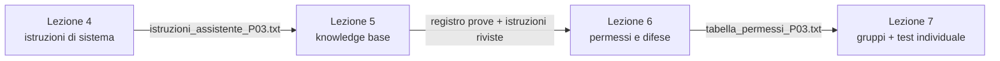

# Bozza del percorso · lezioni 4–7 con Unsloth Studio in locale

Documento riservato al docente. **Bozza da approvare**: non sono ancora materiali per gli studenti e nessuna attività è stata provata sulle VM della scuola. Le risorse vengono da `RICERCA_ATTIVITA_ONLINE.md`, dove sono indicati esiti della validazione, termini d'uso e fonti.

## Struttura

| Incontro | Durata | Contenuto |
| --- | --- | --- |
| Lezione 4 | 2 ore | Modello locale e istruzioni di sistema |
| Lezione 5 | 2 ore | Documenti e recupero (RAG) |
| Lezione 6 | 2 ore | Agenti, permessi e difese |
| Lezione 7 | 4 ore | Lavoro di gruppo e test individuale |

## Vincoli

- **VM della scuola: al massimo 8 GB di RAM, nessuna GPU.** Unsloth Studio dichiara il funzionamento su sola CPU ([Chat](https://unsloth.ai/docs/new/studio/chat)); memoria e tempi sulla VM sono da misurare.
  - Un solo modello GGUF piccolo e quantizzato, caricato prima della lezione.
  - Niente Model Arena (carica due modelli), addestramento, esportazioni o conversioni.
  - RAG in modalità BM25, già indicata in `materiali_aula/RISORSE_E_ACCESSO.md` §3.1.
- **Siti esterni dal browser del PC fisico**, Unsloth Studio nella VM. La memoria della VM resta per Studio e per il modello. Restano esclusi gli strumenti che richiedono WebGPU (WebLLM, Qwen3 Embedding Scatterplot) finché non si conoscono le schede grafiche dei PC fisici.
- **La lezione 3 non è ancora stata svolta.** La lezione 4 non presuppone risultati, file o agenti della lezione 3; eventuali richiami si decidono dopo averla svolta.
- Regole del progetto: gli studenti scrivono e correggono le proprie istruzioni; i casi di prova li inventano loro; nessuna attività si basa sull'errore atteso del modello; le istruzioni di esempio si pubblicano dopo il tentativo, in una cartella separata; nessun tempo di completamento nei materiali.

## Filo conduttore

Ogni studente costruisce sulla propria VM un **assistente di reparto per la P03**. Ogni lezione riusa i file prodotti nella precedente; nella lezione 7 il gruppo lo estende a un documento nuovo e lo fa collaudare da un altro gruppo.

## Lezione 4 · Un modello che gira sul tuo computer

Obiettivo: capire che cosa vuol dire usare un modello in locale e progettare istruzioni di sistema vere.

1. **Come sceglie la parola successiva** · [Transformer Explainer](https://poloclub.github.io/transformer-explainer/), browser del PC fisico. Le coppie scrivono una frase breve in inglese, prevedono come cambieranno le probabilità alzando o abbassando la temperatura, poi osservano e spiegano la differenza. Si osservano le distribuzioni, non si cerca un errore.
2. **Che cosa occupa il modello** · Unsloth Studio + monitor di sistema della VM. Ogni studente annota la memoria prima del caricamento, a modello caricato e durante una risposta, insieme al tempo di risposta. La coppia confronta le misure e spiega perché sulla VM gira solo un modello piccolo. Facoltativo: [OCTOO VRAM Calculator](https://octooai.com/llm-vram-calculator/) per un server di reparto con GPU, tenendo distinta la stima dalla misura sulla VM.
3. **Quanto pesa il testo** · [The Tokenizer Playground](https://huggingface.co/spaces/Xenova/the-tokenizer-playground). Gli studenti contano i token di un estratto del diario P03 e di una versione riscritta da loro, e verificano in Studio se il tempo di risposta cambia.
4. **Scegliere i parametri** · Unsloth Studio. La coppia fissa prima i criteri di una buona estrazione (campi da trovare in un breve estratto del diario), prova più impostazioni di temperatura, top-p e top-k ripetendo la stessa richiesta e sceglie l'impostazione motivandola.
5. **Il campo di sistema** · Unsloth Studio. Ogni studente scrive nel campo System Prompt le istruzioni di un assistente che fa domande prima di rispondere quando mancano dati. Il compagno inventa casi di prova e tranelli; poi ciascuno corregge le proprie istruzioni.

Consegne: `misure_VM.txt` (tabella con celle vuote), `istruzioni_assistente_P03.txt`, `casi_di_prova.txt`.
Esempio di istruzioni in `da_pubblicare_dopo_prova_sistema/`.

## Lezione 5 · Il modello legge i documenti

Obiettivo: rendere visibile il recupero dei passaggi e distinguere un errore di recupero da un errore di risposta.

1. **Tagliare il testo in blocchi** · [ChunkViz](https://chunkviz.up.railway.app/). Le coppie fissano un criterio («macchina, orario, allarme e causa nello stesso blocco»), confrontano dimensioni, sovrapposizione e tipo di divisione, e motivano la scelta. Poi si confronta la scelta con la divisione fissa di Studio, che non si imposta da ChunkViz.
2. **Parole esatte o significato** · [Vector Search Methods Comparison](https://huggingface.co/spaces/arad1367/Vector_Search_Methods_Comparison), riquadro BM25. Breve illustrazione con esempi fissi, prima dei documenti veri.
3. **Knowledge base BM25** · Unsloth Studio, con il corpus del laboratorio (`laboratorio/corpus/`: P03, P30, catalogo ricambi, bolla). Gli studenti scrivono domande di tipi diversi (codice esatto, più fonti, dato assente, P03 o P30), guardano i passaggi recuperati, cambiano il numero di passaggi e correggono la domanda, il documento o le istruzioni della lezione 4.
4. **Documento aggiornato** · Unsloth Studio. Si sostituisce il catalogo con la revisione 2 e si ripete la prova in una nuova conversazione.

Consegna: registro delle prove (domanda, passaggi recuperati, risposta, giudizio, correzione) in tabella con celle vuote, con i giudizi `OK`, `ERRORE`, `NON_ESEGUITO` già usati in `laboratorio/docente/SOLUZIONI.md`.

## Lezione 6 · Agenti: strumenti, permessi e difese

Obiettivo: vedere che cosa fa un agente oltre a scrivere testo e dove si mettono le protezioni.

1. **Istruzioni nascoste** · [HackMerlin](https://hackmerlin.io/). Per ogni livello affrontato la coppia scrive quale istruzione di difesa immagina, poi confronta le ipotesi con le istruzioni reali dei livelli pubblicate su [GitHub](https://github.com/bgalek/hackmerlin.io). Superare i livelli non è richiesto. Scelto rispetto a Gandalf perché le istruzioni reali sono leggibili; [Gandalf](https://play.lakera.ai/gandalf) resta come alternativa se HackMerlin non è raggiungibile.
2. **Dentro un agente** · [Prompt Airlines](https://promptairlines.com/). Prima una richiesta legittima: le coppie annotano quali strumenti l'agente chiama, con quali dati e con quale risultato, distinguendo ciò che l'agente scrive da ciò che esegue. Poi propongono un test e analizzano sia la riuscita sia il rifiuto.
3. **Istruzioni dentro un documento** · Unsloth Studio. Ogni studente inserisce in un documento sintetico della knowledge base del compagno una nota che contiene un'istruzione. Il compagno controlla se il proprio assistente la tratta come dato o come ordine; entrambi gli esiti si analizzano e si decide che cosa protegge davvero: istruzioni, permessi o controllo umano.
4. **Tabella dei permessi** · Unsloth Studio, esecuzione di codice. Solo se il collaudo sulla VM riesce: la coppia decide che cosa l'assistente può fare da solo, che cosa deve chiedere e che cosa gli è vietato, poi prova un calcolo eseguito e lo confronta con un riepilogo calcolato con regole note. Senza collaudo positivo la tabella si progetta senza esecuzione.

Consegne: `tabella_permessi_P03.txt`, istruzioni riviste.

## Lezione 7 · Lavoro di gruppo e test individuale

Riprende il blocco «Sfida e restituzione» già progettato in `laboratorio/docente/SOLUZIONI.md` §8 (documento nuovo DOC-T10, domande T07–T09, verifica individuale), adattato al percorso delle lezioni 4–6.

### Prima parte · Lavoro di gruppo

- **Gruppi di quattro**, ognuno sulla propria VM. Il gruppo divide il lavoro per argomento: istruzioni di sistema, documenti, permessi, casi di prova.
- **Consegna del gruppo**: estendere l'assistente P03 a un **documento nuovo scritto dal gruppo** (DOC-T10: titolo, data, revisione, due dati sintetici con macchina e unità, un dato lasciato volutamente fuori dal documento). Il gruppo aggiorna istruzioni, knowledge base e tabella dei permessi.
- **Collaudo incrociato**: ogni gruppo prepara per un altro gruppo un pacchetto di tranelli inventati (dato assente, P03 o P30, revisione vecchia, istruzione nascosta in un documento, richiesta di azione non permessa). Il gruppo ospite, non l'autore, formula le domande sul DOC-T10, come previsto per T08/T09.
- **Correzione e restituzione**: ogni gruppo corregge dove il collaudo ha trovato falle e presenta alla classe una falla e la correzione, con i passaggi recuperati come prova. Non si valuta la percentuale di risposte corrette del modello.

Consegna del gruppo: istruzioni finali, DOC-T10, registro del collaudo incrociato, tabella dei permessi.

### Seconda parte · Test individuale

- **Parte scritta**, mista: domande aperte brevi e domande a scelta multipla con motivazione. Riguardano casi descritti dal docente, dichiarati come esempi scritti a mano e non come risposte reali del modello. Argomenti: locale o cloud e memoria, temperatura e token, messaggio di sistema e messaggio utente, blocchi e numero di passaggi, errore di recupero o di risposta, catalogo corrente o storico, dato o istruzione dentro un documento, che cosa deve essere un permesso e non un'istruzione. Le quattro domande della verifica individuale in `SOLUZIONI.md` §8 si riusano.
- **Parte pratica sulla propria VM**: un documento breve nuovo preparato dal docente e una richiesta. Lo studente decide le domande di controllo, registra passaggi recuperati, risposta e giudizio (`OK`, `ERRORE`, `NON_ESEGUITO`) e propone una correzione motivata.
- **Valutazione**: griglia e peso del lavoro di gruppo rispetto al test individuale da definire. La griglia di `SOLUZIONI.md` §8 è un punto di partenza, ma comprende anche il mini-dataset, che non è nel percorso.

## Da verificare prima delle lezioni

**Prossimo passo, da fare:** prova preliminare di Unsloth Studio sul computer del docente, limitato a 8 GB di RAM e senza GPU: memoria e tempi con un modello da 1,5B e uno da 3–4B, campo System Prompt, knowledge base BM25, esecuzione di codice. Non sostituisce la prova sulle VM della scuola.

| Punto | Controllo |
| --- | --- |
| Modello | Qwen2.5-1.5B Q4_K_M e un modello 3–4B quantizzato: memoria, tempi con tutte le VM accese, capacità di seguire istruzioni in italiano |
| Unsloth Studio | Versione installata, campo System Prompt, parametri, knowledge base, impostazioni di recupero, esecuzione di codice |
| Memoria | Studio e modello entro 8 GB durante indicizzazione e risposta |
| Corpus | Coerenza di `laboratorio/corpus/` con i dati P03 della lezione 3: stessa macchina, date compatibili, quantità che tornano |
| Siti esterni | Transformer Explainer, Tokenizer Playground, ChunkViz, Vector Search Methods Comparison, HackMerlin, Gandalf, Prompt Airlines dalla rete della scuola e dal browser del PC fisico; limiti per IP, termini, età |
| Collaudo incrociato | Modo di scambiare documenti e istruzioni fra VM (cartella condivisa, chiavetta, posta scolastica) |

## Decisioni

| Tema | Stato |
| --- | --- |
| Formato del test scritto | **Deciso:** misto, domande aperte brevi e a scelta multipla con motivazione. |
| Dataset e addestramento | **Deciso:** fuori dal percorso; con 8 GB e senza GPU non si eseguono. |
| Griglia di valutazione | Da definire. |
| Peso del lavoro di gruppo e del test individuale | Da definire. |
