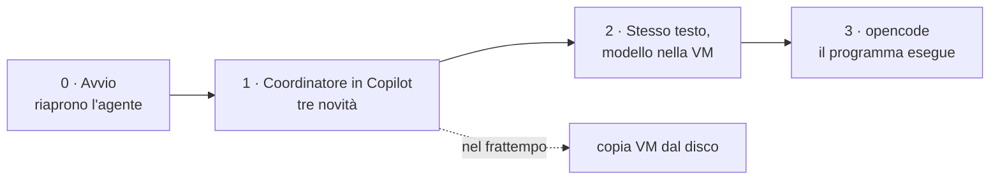

# Piano della lezione 5 · 18 novembre 2026

Documento riservato al docente. Struttura approvata il 12 novembre; resta come storico delle decisioni. Per lo stato attuale (slide, consegna, controlli pre-aula) vale la guida docente: alcune righe qui sotto sono superate (percorso `da_pubblicare_dopo_collaudo`, caricamento del modello in aula, previsioni «dai PC»). Nasce dalle indicazioni del 12 novembre 2026, a lezione 4 svolta: «ripartire dall'esercizio Ruota Libera con più caratteristiche del coordinatore, complicando l'agente; poi Unsloth Studio e opencode, il modello gira anche se lento».

## Come ho letto le indicazioni

| Hai detto | Lo traduco in |
| --- | --- |
| Si riprende da Ruota Libera | Gli studenti riaprono il proprio agente di Copilot e il proprio `istruzioni_agente_noleggio.txt`. Nessun caso nuovo: stessi tre testi, stessa bici 12 della lezione 4. |
| Più caratteristiche dell'orchestratore, complicare l'agente | Tre novità, solo tre: **piano mostrato prima di agire**, **rimborso separato da FUORI SERVIZIO, con tre lavori in una richiesta**, **controllo finale con la fonte di ogni numero**. Dettaglio sotto. |
| Poi Unsloth e opencode | Lo stesso testo passa da Copilot a un modello piccolo nella VM, poi a un programma che **esegue** davvero il coordinamento. |
| Il modello gira, ma è lento | La lezione non deve dipendere dalla velocità: la parte lenta si alterna a lavoro che non richiede il modello, e ogni passo ha una via d'uscita se il modello non risponde in tempo. |

Il filo è quello di tutto il percorso: lezione 4 «prima i pesi, ora il testo»; lezione 5 «prima il testo, ora chi lo esegue».

## Il passaggio in una tabella

Ogni parte del loro agente ha un corrispondente nel programma. Si mostra una versione ridotta di questa tabella a fine parte 3, dopo che l'hanno visto fare: testi, piano, permesso.

| Nel loro file di istruzioni | In Copilot (lezione 4) | In opencode (lezione 5) |
| --- | --- | --- |
| Regole per tutti i casi | testo dell'agente | corpo del file del coordinatore |
| Elenco delle richieste | frase che Copilot legge e interpreta | descrizione di ogni agente di lavoro: la legge il coordinatore per scegliere |
| Un lavoro | quattro righe dentro lo stesso testo | un file `.md` a parte, con proprie istruzioni e propri permessi |
| «Lavoro usato:» | riga scritta dal modello, da controllare | chiamata registrata dal programma, visibile nell'elenco dei passaggi |
| «PROPOSTA DA CONTROLLARE» | parole nel testo | permesso `ask`: il programma si ferma e chiede conferma prima di scrivere un file |
| I tre testi incollati nel messaggio | tutto nello stesso messaggio | ogni agente di lavoro legge solo il suo file |

Il vantaggio concreto, da misurare e non da dichiarare: con un modello piccolo e un contesto corto, far leggere a ogni lavoro solo il suo testo evita di riempire il contesto con tutti e tre i documenti (circa 2.000 parole insieme).

## Struttura

La parte 1 usa solo il browser. Piano e guida erano in contrasto sul momento della copia della VM; il 13 novembre il piano è stato allineato alla guida: VM copiate e accese prima dell'aula (da confermare). Così la copia non occupa il tempo della parte 1 e sui PC con la VM restano aperti solo Copilot e Blocco note.

### Parte 0 · Si riparte dall'agente

- Azione: aprire Copilot, riaprire il proprio agente, inviare di nuovo l'ultima richiesta della lezione 4 (registro incollato, richiesta in fondo). Serve a vedere che l'agente salvato funziona ancora.
- Chi non ha il file o non ha finito: parte dall'esempio `studenti/da_pubblicare_dopo_collaudo/ESEMPIO_ISTRUZIONI_AGENTE_NOLEGGIO.txt`, che nella lezione 4 era già stato proiettato. Lo si ripubblica come punto di partenza, non come soluzione. **Da confermare con te** (vedi domande).
- Nome: «coordinatore» è la parola degli studenti per il lavoro che sceglie quali lavori usare e in che ordine; «orchestratore» lo dici tu a voce alla fine.

### Parte 1 · Tre novità per il coordinatore (Copilot, browser)

Una novità alla volta, ognuna con previsione prima e criterio dopo, come nella lezione 4. Ogni novità sta in poche righe aggiunte al file; gli studenti le scrivono, non le ricevono già pronte.

| Novità | Che cosa cambia nel comportamento | Richiesta di prova (la inventano loro, con un esempio dalla pizzeria) |
| --- | --- | --- |
| 1 · Il piano prima | Per le richieste con più lavori l'agente scrive **prima il piano** («Piano: 1 FUORI SERVIZIO, 2 PASSAGGIO; testi: registro e regole») e si ferma. Risponde solo dopo un «Procedi». L'utente può correggere il piano. | Una richiesta con due lavori; poi una correzione del piano («no, solo il passaggio»). |
| 2 · Il rimborso diventa un lavoro | **Correzione rispetto alla prima versione del piano:** nella lezione 4 il rimborso era già dentro FUORI SERVIZIO (slide 33–35), quindi non è un lavoro nuovo e non «dipende» dal fuori servizio: conta altri minuti (dalla segnalazione al cambio) e un dato che il registro non ha (tipo di noleggio, da chiedere). Gli studenti lo **separano** in un lavoro RIMBORSO a quattro righe e aggiornano l'elenco delle richieste. La richiesta di prova ha tre lavori: FUORI SERVIZIO, RIMBORSO e il secondo lavoro scelto in lezione 4 (GUASTI o PASSAGGIO). Il piano si ferma a chiedere il tipo di noleggio. | Richiesta a tre lavori della slide 15, uguale per tutti nella forma e diversa nel secondo lavoro. |
| 3 · Il controllo | Alla fine l'agente elenca ogni numero usato con la riga del testo da cui viene. Se non la trova, lo dice. È il controllo esterno che le regole del progetto chiedono quando l'informazione passa da uno strumento all'altro. | Qualunque richiesta con un calcolo: si controlla che la riga indicata esista davvero. |

Perché queste tre e non altre: sono le funzioni che in opencode diventano **visibili** (piano → modalità Plan, lavori separati → un agente per lavoro, controllo → lettura del file da parte del programma). Non si aggiungono difficoltà per far sbagliare il modello.

Dati: il rimborso è un calcolo sullo stesso registro e sulle stesse regole (formula in `Regole_noleggio_Ruota_Libera.txt` §4). Nessun documento nuovo, quindi nessun rischio di incoerenza fra testi. I valori di riferimento vanno prodotti da `genera_materiali.py` con la solita verifica, non trascritti: `{{RIMBORSO_A_ORE}}` e `{{RIMBORSO_GIORNATA}}` delle slide non esistono ancora nello script, vanno aggiunti accanto a `{{MINUTI_SENZA_BICI}}`, `{{ORA_SEGNALAZIONE}}` e `{{ORA_CAMBIO}}`, che ci sono già.

Chiusura della parte: nomi. «Ognuno di voi ha appena fatto il lavoro del coordinatore: scegliere i lavori, l'ordine, fermarsi a chiedere, controllare.»

### Parte 2 · Stesso testo, un altro modello (Unsloth Studio nella VM)

- Azione: accendere la VM, aprire Studio, caricare il modello (già presente), incollare **le proprie istruzioni** nel campo System Prompt, incollare registro e regole, inviare **la stessa richiesta** della parte 1.
- Che cosa si osserva: tempo di risposta, lunghezza, se rispetta «Lavoro usato:» e il piano, se arriva a fare il calcolo giusto. Nessuna aspettativa che sbagli: un risultato corretto vale come uno sbagliato.
- Ritorni alla lezione 4: **Temperature** è la stessa manopola di Transformer Explainer; il modello è un file da circa 1,3 GB con i suoi pesi; Context Length e memoria stimata si leggono nel pannello. «Copilot e questo modello leggono lo stesso testo e non lo leggono allo stesso modo.»
- Passaggio dei dati: il file originale resta quello del Blocco note; si controlla che il testo incollato sia arrivato intero.
- Se il modello non risponde in tempo o la VM non parte: proiettore con la VM del docente, gli studenti guardano e propongono la richiesta.
- Disattivare **Search** e **Tools** nella casella dei messaggi se non servono: Search usa la rete, che qui non si deve usare.

### Parte 3 · opencode: il programma che coordina

Due passi. **Entrambi dipendono dalle chiamate agli strumenti**: 3A e 3B sono eseguibili dagli studenti solo se la prova sulla VM (seconda riga della tabella delle verifiche) riesce con il modello consegnato. Se non riesce, vale il ramo di riserva dopo la tabella delle verifiche, che non è un'esecuzione degli studenti.

| Passo | Azione dello studente | Che cosa si vede |
| --- | --- | --- |
| 3A · Il programma legge | In una cartella con i tre testi, avviare opencode dal collegamento sul desktop. Chiedere: «Quale codice hanno le pastiglie montate sulla bici 12?» (la risposta sta solo nel registro) | Il modello **chiede** di leggere il registro; il programma lo fa e restituisce il testo. Chi legge il file è il programma, non il modello. |
| 3B · Piano e permessi | Passare da Plan a Build. Chiedere: «Crea il file nota_passaggio.txt con una sola riga: Controllare i freni della bici 12.» | In Plan il programma non scrive. In Build compare la richiesta di conferma; il gruppo decide se approvare o rifiutare. È la differenza fra proposta e azione eseguita. |

Documentazione: [Agents](https://opencode.ai/docs/agents/) per i permessi e le modalità Plan e Build; i `subagent` e i file degli agenti non sono più nella lezione (tolta la 3C il 12 novembre); permessi `allow`/`ask`/`deny` e limite di passaggi; [Unsloth e opencode](https://unsloth.ai/docs/integrations/opencode) per `unsloth start opencode`. La seconda è scritta per modelli grandi (27B): per il 2B la prova è nostra.

Fuori dalla lezione: nessuna modifica di codice, nessun accesso a file fuori dalla cartella del noleggio, nessuna configurazione di fornitori. Il programma lavora su una cartella preparata dal docente.

Esito atteso a fine lezione, a voce: «il coordinatore non è magia del modello: è un ciclo eseguito da un programma che chiede, esegue e riporta; i permessi decidono che cosa può fare da solo». Prepara la lezione 6.

## VM condivise: una ogni 4–5 postazioni (decisione del 12 novembre, forma approvata)

Le VM non sono su ogni PC ma su uno ogni quattro o cinque; potenzialmente si possono mettere su tutti. Il lavoro singolo delle lezioni 3–4 vale ancora per la **parte 1**, che usa solo Copilot nel browser del proprio PC. Per le parti 2 e 3 cambia il modo di lavorare.

| Aspetto | Effetto |
| --- | --- |
| Copia della VM | Da 22 copie a 5 o 6: il rischio più grosso della tabella delle verifiche si riduce molto |
| Memoria | Solo i PC con la VM hanno il carico di 6 GB in più; gli altri restano leggeri |
| Velocità | Un modello da 2B solo CPU risponde una richiesta alla volta e in modo lento. Quattro o cinque studenti che scrivono insieme sulla stessa VM si mettono in coda: non si può far provare a ognuno la propria richiesta |
| Lavoro in aula | Le parti 2 e 3 diventano lavoro di gruppo attorno a una VM. Il risultato è uno per gruppo |

Forma approvata il 12 novembre per le parti 2 e 3 (la parte 1 non cambia):

- **Parte 2:** il gruppo sceglie **un solo file di istruzioni**, quello che nella parte 1 ha superato meglio la richiesta a tre lavori con i criteri delle slide 9 e 17, lo incolla nel System Prompt e invia **una** richiesta. Gli altri, dai loro PC, scrivono prima cosa si aspettano e poi confrontano. Si discute: che cosa ha tenuto il modello piccolo e che cosa no.
- **Parte 3:** un passo per volta, con una persona diversa ai comandi. Gli altri prevedono sul proprio PC la risposta e la riga di permesso, prima di vedere il risultato.
- **Alternativa non adottata:** i PC senza VM si collegano alla VM del gruppo dal browser. Richiede che Studio ascolti sulla rete e che la rete della scuola lo permetta; con quattro richieste lunghe insieme la coda sulla CPU peggiora la lentezza. Non è stata provata: se interessa, è una verifica da aggiungere.

Slide 22–37 e consegna (parti 2 e 3) sono riscritte per questa forma. Il file dell'autore arriva sul computer del gruppo con una chiavetta (deciso il 13 novembre; da provare sulla VM).

## Recupero di documenti (RAG) con il modello installato

Letto il codice di Unsloth Studio 2026.11.4, la stessa versione della VM, installato sul portatile del docente; **non** eseguito un indice completo né provato nella VM.

- **L'embedding non lo fa il modello della chat.** Qwen3.5-2B scrive le risposte. Per cercare i passaggi Studio usa un modello a parte, di default `unsloth/bge-small-en-v1.5`: un file GGUF di 67,6 MB (F16), scaricato da Hugging Face al primo uso. Nella VM, senza PyTorch e senza scheda grafica, `auto` sceglie un secondo processo `llama-server` in CPU.
- **BM25 non evita l'embedding.** L'indicizzazione calcola sempre i vettori (`ingestion.py`, `_embed_all`, nessuna condizione sulla modalità). Il selettore «BM25 only» cambia solo la ricerca. La domanda aperta della ricerca precedente («il caricamento evita il modello di embedding?») ha risposta no.
- **Serve la rete al primo uso.** Il modello di embedding va scaricato prima, a casa, e deve restare nella cache della VM. Sul portatile del docente è in cache dal 4 novembre; nella VM non è stato controllato.
- **L'italiano.** Il modello predefinito è in inglese. Per documenti in italiano la modalità «BM25 only» è la scelta sicura. «Hybrid» e «Semantic only» vanno provate, non date per buone. Altre opzioni esistono come GGUF multilingue (per esempio `Qwen/Qwen3-Embedding-0.6B-GGUF`, Apache-2.0, e `unsloth/embeddinggemma-300m-GGUF`, licenza Gemma), ma sono più grandi e non provati con Studio; cambiare modello richiede di rifare l'indice.
- **Passaggi e contesto.** I blocchi sono da 500 token; il cursore Passages (top K) va da 1 a 20. Con il modello da 2B e contesto di 8.192 token, 10 passaggi occupano da soli circa 5.000 token: per la lezione 6 provare 3–4.
- **Documenti brevi interi.** `RAG_THREAD_WHOLE_DOC` è attivo di partenza: un file allegato a una conversazione sotto i 6.000 token viene inserito intero, senza ricerca. Il registro del noleggio (circa 1.100 parole) resta sotto la soglia. Va impostata `RAG_THREAD_WHOLE_DOC=0` prima di avviare Studio per vedere il recupero, e va verificato se vale anche per le raccolte.

Conseguenza per la lezione 6: il RAG con il registro e le regole del noleggio è possibile, ma i testi sono corti e restano interi in contesto; per vedere il recupero serve la variabile spenta o un testo più lungo. Da decidere quando si progetta la lezione 6.

## Verifiche da fare prima, sulla VM (6 GB, 4 processori)

Le prove del 12 novembre dicono che modello e Studio rispondono in italiano e che opencode parte. Non dicono le cose seguenti, che decidono la forma della parte 3.

| Controllo | Perché conta | Se fallisce |
| --- | --- | --- |
| Tempo alla prima parola con registro + regole (circa 3,5–4k token) e con il testo di opencode (istruzioni e definizioni degli strumenti, migliaia di token) | «Lento» può voler dire secondi o minuti; la prima risposta di opencode deve elaborare molto più testo di una chat | Parte 3 come dimostrazione del docente con il ramo di riserva sotto |
| opencode collegato al modello nella VM: una richiesta di lettura file produce la chiamata allo strumento nel formato giusto. Provare più volte, perché un solo successo non basta | I modelli molto piccoli possono sbagliare il formato delle chiamate agli strumenti (rischio già annotato nella ricerca sugli agenti, su un modello da 1,5B) | 3A e 3B non sono eseguibili dagli studenti: ramo di riserva sotto |
| Permesso `ask` sulla scrittura in Windows, con la richiesta che arriva davvero dal modello | È il passo che fa vedere la differenza fra proposta ed esecuzione. Richiede che il secondo controllo sia superato | Si toglie 3B; resta 3A se il secondo controllo è superato, altrimenti ramo di riserva |
| RAM del PC reale con VM da 6 GB accesa, browser e Copilot aperti (solo sui PC con la VM) | Da fermo il PC usa già 6,9 GB su 15,6: con VM e browser si va oltre 13 GB | Chiudere Copilot prima della parte 2 |
| Come arriva il file dell'autore sul computer del gruppo | Teams è lento e nella VM non ci sono accessi di nessuno; il file sta sul PC dell'autore | Chiavetta, oppure copia e incolla del testo dal PC dell'autore alla VM con VMware Tools; decidere e provare prima |
| I tre testi del noleggio nella cartella `noleggio` della VM | Le slide 26 e 32 li danno per presenti; nella VM non si scaricano da Teams | Copiarli nell'immagine prima della consegna e controllare il percorso |
| Copia della VM su 5 o 6 PC | Dimensione immagine e tempo di copia mai misurati; VMware chiede «spostata o copiata» alla prima accensione | Copia prima dell'aula; un gruppo si unisce a un altro se la copia non finisce |
| Nuova finestra: `unsloth start opencode` senza il PATH della sessione di prova | Nelle note di costruzione opencode non è stato provato da una finestra nuova | Fornire un collegamento sul desktop |
| Modello caricato prima di avviare opencode e Context Length scelto | Con Auto il contesto occupava più memoria nelle prove su Linux | Impostare 8192 nella VM consegnata |

### Ramo di riserva della parte 3: se il modello della VM non produce chiamate agli strumenti

Senza chiamate, opencode non legge né scrive nulla: non esiste una versione «più semplice» eseguibile con quel modello. Le alternative sono tre, da scegliere dopo le prove e da dichiarare agli studenti per quello che sono:

| Alternativa | Che cosa è | Condizione | Come si dichiara |
| --- | --- | --- | --- |
| a · Registrazione di una prova riuscita | Schermate o registrazione dell'esecuzione 3A–3B riuscita nella VM, con il modello consegnato | Solo se la prova è riuscita davvero, più volte, e si conserva la registrazione | «Esecuzione reale registrata prima della lezione.» |
| b · Esecuzione dal vivo con un modello più grande | Il docente avvia opencode sul proprio PC con un modello più grande, già collaudato | Collaudo prima della lezione; modello e PC sono diversi da quelli degli studenti | «Esecuzione reale con un altro modello, non quello della VM.» |
| c · Prova a secco su carta | Gli studenti seguono la tabella di sopra su un esempio scritto: «il modello chiede di leggere, il programma legge, il modello risponde» | Nessuna | «Non è un'esecuzione: è uno schema scritto a mano. Non prova che opencode funzioni con questo modello.» |

Non si presentano testi scritti a mano come registrazioni del modello. La lezione resta in piedi anche con la sola alternativa c, perché le parti 1 e 2 sono eseguibili senza opencode; la parte 3 diventa un quadro del funzionamento, non un'esperienza. Se la prova riesce solo in parte (per esempio la lettura sì, il permesso `ask` no), si tiene l'alternativa a per ciò che è riuscito e la c per il resto.

## Che cosa cambia nelle lezioni 6 e 7 (proposta)

Spostare i contenuti non è deciso. Se la lezione 5 prende il coordinatore e i permessi di base, la lezione 6 si alleggerisce:

| Lezione | Contenuto precedente | Proposta |
| --- | --- | --- |
| 5 | Documenti e recupero (RAG) | Coordinatore, modello locale, opencode |
| 6 | Agenti, permessi e difese | Documenti e recupero (BM25 in Studio) **e** permessi/difese: la tabella dei permessi riprende quanto visto in 3B |
| 7 | Gruppi e test finale | invariata; il gruppo estende l'agente a un documento nuovo e ai permessi |

Il materiale RAG già progettato (ChunkViz, BM25, documento aggiornato) resta nel file `BOZZA_PERCORSO_LEZIONI_4-7.md` come materiale in attesa di collocazione.

## Domande per te

1. Che cosa è successo davvero in lezione 4? **Risposta del 13 novembre:** gli studenti hanno scritto da soli l'agente, ognuno il suo, a partire dai tre testi, con l'incarico di costruire un chatbot per il noleggio che rispondesse alle richieste dei clienti (rimborso, aiuto con i guasti). Resta da sapere quanti hanno il file `istruzioni_agente_noleggio.txt` e se il rimborso era una richiesta a sé.
2. Parti 2 e 3 in gruppi di 4–5 attorno a una VM, con un file scelto per gruppo e un pilota diverso a ogni passo: va bene? Oppure preferisci un altro modo di dividersi?
3. Parola per gli studenti: «coordinatore» (la mia proposta, in aula) o «orchestratore»? Regola del progetto: i nomi tecnici stanno nella guida docente.
4. Posso spostare il RAG alla lezione 6 come sopra?

## Ordine di lavoro se approvi

1. Prove sulla VM della tabella sopra (tu, a casa): sono quelle che fissano la parte 3.
2. Aggiungere a `genera_materiali.py` il lavoro RIMBORSO, il piano e il controllo con i valori di riferimento (script, non a mano).
3. Slide e consegna di lezione 5 in Markdown, scritte con le regole di «Chiarezza didattica» (quadro prima, un'azione per slide, schermate reali di Studio e opencode ricavate dalla VM, non di Copilot).
4. Guida docente con tabella di verifica pre-aula e rami di riserva.
5. Cartella `studenti/da_pubblicare_dopo_collaudo/` con un esempio per il coordinatore in Copilot, e un modello di file per opencode (solo righe tecniche).
6. Revisore didattico: stima dei tempi nel suo rapporto, non nei materiali.

## Stato dei lavori (12 novembre 2026, dopo la generazione)

Decisioni assunte per partire, ancora da confermare: «coordinatore» come parola per gli studenti, RAG alla lezione 6, punto di partenza per chi non ha il file (ora in `studenti/da_pubblicare_a_chi_non_ha_il_file/`). Approvate: parti 2 e 3 in gruppi di 4–5 attorno a una VM; dopo la revisione (12 novembre) prova unica per RIMBORSO e controllo, una sola richiesta inventata, 3C tolta.

| File | Stato |
| --- | --- |
| `docente/genera_materiali.py` | Fatto. Autonomo, copiato dalla lezione 4; produce PowerPoint (37 slide), HTML, Word e PDF. Aggiunti i valori del rimborso (`{{RIMBORSO_A_ORE}}`, `{{RIMBORSO_GIORNATA}}`): a ore 3,75 euro, a giornata 2,25 euro, su 45 minuti senza bici |
| Slide, consegna, guida docente | Generati e guardati: nessun segnaposto residuo, fascia in basso aggiornata («Copilot · Unsloth Studio · opencode»). Il PowerPoint non è stato aperto in PowerPoint, solo convertito con LibreOffice |
| `docente/MODELLI_OPENCODE/` | `opencode.jsonc`, scritto dalla documentazione, **non provato**. Senza il file la modalità Build scrive senza chiedere. Gli agenti `coordinatore.md` e di lavoro sono stati tolti con la 3C |
| `studenti/da_pubblicare_a_chi_non_ha_il_file/` | Copia del testo mostrato nella lezione 4 con una nuova intestazione |
| Schermate di Studio e opencode | **TODO**, dalla VM (nessuna immagine nelle slide per ora) |
| Revisione del `revisore-didattico` | Due passaggi il 12 novembre. Primo: DA CORREGGERE (troppo lunga, circa 135 minuti tarati); il docente ha approvato i tagli (prova unica per RIMBORSO e controllo, una sola richiesta inventata, 3C tolta). Secondo: DA CORREGGERE, stima tarata circa 119 minuti («al limite alto: non aggiungere contenuti»); corretti tutti i problemi tranne uno. Il problema N1 (nessuna schermata di Studio e opencode, regola «Schermate dove servono» di `AGENTS.md`) è **TODO per decisione del docente (12 novembre)**: schermate da catturare nella VM, elenco nella sezione «TODO prima dell'aula» della guida; non mostrare quelle dell'elenco dei passaggi e del permesso. Il 13 novembre due passaggi. Terzo: DA CORREGGERE (9 importanti, 8 minori), stima tarata circa 108 minuti; applicate le correzioni, slide 15 divisa in due (37 slide), scartata la proposta di far provare la richiesta inventata al vicino. Quarto: DA CORREGGERE (3 importanti sulla guida e su `opencode.jsonc`, 11 minori); corretti: regole `ask` nell'elenco generale dei permessi (valgono anche in Plan), ripristino della VM prima della copia, chiavette fra i materiali, risposte tolte dalla consegna, domanda finale sul rimborso. Resta da fare: le schermate, il gesto Plan→Build, le prove nella VM |

Non fatto e non dichiarato fatto: nessuna prova in Copilot con l'account studente, nessuna prova di Studio o opencode da parte degli studenti, nessuna prova di apertura in PowerPoint. Da verificare anche la licenza di Unsloth Studio prima di citarla nei materiali (nel codice installato i file sono AGPL-3.0, `config.py`; per i materiali non serve ancora).
