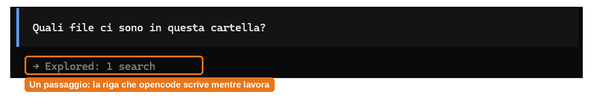

# Slide 01 — Chi controlla che cosa?
<!-- layout: COPERTINA -->

Un agente con più lavori, un modello sul vostro computer e un programma che agisce sui file.

ITS MAKER · 18 novembre 2026 · Microsoft Copilot, Unsloth Studio e opencode

---

# Slide 02 — Riaprite il vostro agente
<!-- layout: CONTENUTO -->

| Dove | Che cosa fate |
| --- | --- |
| Microsoft Copilot | aprite il vostro agente del noleggio, in una nuova conversazione |
| Messaggio | registro, regole del noleggio, e in fondo la richiesta |

> «Per quanti minuti è stata fuori servizio la bici 12 sabato? Mostrami gli orari.»

---

# Slide 03 — Il percorso di oggi
<!-- layout: CONTENUTO -->

| Passo | Dove | Che cosa succede |
| --- | --- | --- |
| 1 | Copilot | il vostro agente ha più lavori: chi sceglie quale usare? |
| 2 | Unsloth Studio | un modello nel computer virtuale: serve la rete? |
| 3 | opencode | un programma accanto ai file: chi li apre? |

Le ultime due domande le risolvete provando. Dal passo 2 lavorate nel computer virtuale: un computer dentro il computer, con il suo Windows e i suoi programmi. Ognuno ha il suo.

---

# Slide 04 — Un elenco e dei lavori
<!-- layout: CONTENUTO -->

Due pezzi dell’agente della pizzeria, con i tagli segnati […]:

| L’elenco dice | Il lavoro dice |
| --- | --- |
| «Pizza fredda o in ritardo, pizza sbagliata → RECLAMO» | «Quando: la pizza è fredda, sbagliata o in ritardo. […] Come rispondere: tre punti.» |
| «Che cosa c’è in una pizza, glutine, allergeni → INFORMAZIONI» | «Quando: il cliente chiede gli ingredienti. Testo da usare: solo la scheda degli ingredienti. […]» |

L’elenco dice a quale lavoro va la richiesta. Il lavoro dice come si risponde. Nel vostro agente li avete scritti voi.

---

# Slide 05 — Cinque richieste, quale lavoro?
<!-- layout: CONTENUTO -->

Cinque lavori: ORDINE, RECLAMO, RIMBORSO, INFORMAZIONI, ORARI. Nel Blocco note scrivete il lavoro che vi aspettate per ogni richiesta: uno, due o nessuno.

| Richiesta | Il vostro pronostico |
| --- | --- |
| «Vorrei due Margherite per le 20:00.» | |
| «La Diavola ha il glutine?» | |
| «La pizza è arrivata fredda e voglio i soldi indietro.» | |
| «A che ora aprite il sabato?» | |
| «Mi prenoti un tavolo per sabato?» | |

---

# Slide 06 — Due lavori in una richiesta
<!-- layout: CONTENUTO -->

Guardate la prima riga della risposta alla pizza fredda: «Lavoro usato:» e due nomi.

Perché in quest’ordine? Che cosa deve passare dal primo lavoro al secondo?

E se il secondo lavoro usasse un numero d’ordine diverso dal primo: chi se ne accorge?

---

# Slide 07 — Il lavoro che manca
<!-- layout: CONTENUTO -->

Scrivete il lavoro che manca: GUASTI se avete PASSAGGIO, PASSAGGIO se avete GUASTI. Servono una voce nell’elenco e il lavoro.

| Domanda | Pizzeria: INFORMAZIONI | Noleggio: voi |
| --- | --- | --- |
| Quando scatta? | «il cliente chiede ingredienti, glutine o allergeni» | per quali richieste? |
| Che testo usa? | «solo la scheda degli ingredienti» | quale testo del noleggio? |
| Se manca un dato? | «Non lo so: chiedi al banco.» | che cosa fa? |
| Come risponde? | in una riga | in quale forma? |

Con il testo di partenza avete già i tre lavori: passate alla prova.

---

# Slide 08 — Aggiornate l’agente
<!-- layout: CONTENUTO -->

Salvate il file. Poi in Copilot incollate tutto il testo nelle istruzioni del vostro agente.

L’ultima riga del file è anche l’ultima in Copilot?

---

# Slide 09 — Provate: una richiesta per lavoro
<!-- layout: CONTENUTO -->

Una nuova conversazione per ogni richiesta: registro, regole del noleggio, guida ai guasti e in fondo la richiesta.

| Il lavoro | La richiesta |
| --- | --- |
| FUORI SERVIZIO | «Bici 12, sabato: per quanti minuti è stata fuori servizio?» |
| GUASTI | «Che cosa significa freni che non tengono?» |
| PASSAGGIO | «Scrivi la nota per il turno dopo, sabato.» |

Prima di inviare: quale lavoro vi aspettate?

---

# Slide 10 — Il lavoro era quello giusto?
<!-- layout: CONTENUTO -->

Guardate la prima riga di ogni risposta. È il lavoro che vi aspettavate?

Se non lo è, non partite dal lavoro: leggete la voce dell’elenco. Dice abbastanza chiaramente quando usarlo?

Una prova riuscita al primo invio vale quanto una riuscita dopo una correzione.

---

# Slide 11 — Un caso che l’elenco non prevede
<!-- layout: CONTENUTO -->

> «La Diavola ha il glutine e quanto costa?»

Nella pizzeria sono due lavori: INFORMAZIONI e ORDINE. Nell’elenco non c’è nessuna riga per questa coppia.

Alzata di mano: parte da INFORMAZIONI, parte da ORDINE, o ne usa uno solo?

---

# Slide 12 — Inventate il vostro caso
<!-- layout: CONTENUTO -->

Una richiesta del noleggio che potrebbe andare a due lavori, o a nessuno. Scrivetela nel Blocco note e, prima di inviarla, scrivete dove la mandereste voi.

Poi provatela. Se va dove non volevate, correggete la voce dell’elenco o aggiungete la riga che manca, e riprovate.

---

# Slide 13 — Due lavori in catena
<!-- layout: CONTENUTO -->

> «Bici 12, sabato: per quanti minuti è stata fuori servizio? Scrivi la nota per il turno dopo.»

Nel vostro elenco deve esserci una riga per FUORI SERVIZIO e PASSAGGIO insieme: prima FUORI SERVIZIO, poi il risultato entra nella nota. Se manca, scrivetela e aggiornate l’agente.

Prima di inviare: quale numero comparirà nella nota?

---

# Slide 14 — Il numero è arrivato intero?
<!-- layout: CONTENUTO -->

## {{MINUTI_FUORI_SERVIZIO}} minuti fuori servizio

{{ORA_FUORI_SERVIZIO}} → {{ORA_DISPONIBILE}}

Sono i minuti e gli orari che il registro dà per la bici 12, sabato. Nella vostra nota, sotto «Fuori servizio»: sono gli stessi?

---

# Slide 15 — Salvate il file
<!-- layout: CONTENUTO -->

Il file `istruzioni_agente_noleggio.txt` deve contenere tutto: regole per tutti i casi, l’elenco delle richieste con le vostre correzioni, i tre lavori, lo stile.

Aggiornate l’agente in Copilot e controllate che il testo sia arrivato intero.

---

# Slide 16 — Chi ha scelto? Chi ha controllato?
<!-- layout: CONTENUTO -->

> Copilot ha scelto il lavoro leggendo l’elenco che avete scritto voi.

Il numero nella nota: chi l’ha controllato?

---

# Slide 17 — Un modello sul vostro computer
<!-- layout: SEZIONE -->

Passate al computer virtuale

---

# Slide 18 — Aprite Unsloth Studio
<!-- layout: CONTENUTO -->

Doppio clic sul collegamento Unsloth Studio del desktop: si apre il browser. In alto deve esserci il nome del modello, Qwen3.5-2B-GGUF. Se non c’è, scegliete Select model › On Device › Qwen3.5-2B-GGUF e aspettate.

Accanto c’è una finestra nera con del testo che scorre: non chiudetela, o Studio si ferma.

---

# Slide 19 — Serve Internet?
<!-- layout: CONTENUTO -->

> Per rispondere, questo modello ha bisogno di Internet?

Alzata di mano: sì o no.

Poi, con il pulsante Nuova chat, scrivete: «In una frase: a che cosa serve un cacciavite?»

---

# Slide 20 — Togliete la rete
<!-- layout: CONTENUTO -->

Togliete la rete al computer virtuale: il docente vi fa vedere come. Poi rifate la stessa domanda, in una nuova chat.

Risponde ancora?

Quando avete la risposta, riattivate la rete: serve a opencode.

---

# Slide 21 — Dove gira?
<!-- layout: CONTENUTO -->

| | Copilot | il modello di Studio |
| --- | --- | --- |
| Dove gira | in rete, sui computer di Microsoft | sul vostro computer virtuale |
| Il codice | non si può leggere | aperto: si può leggere |
| Di chi è | di Microsoft | vostro: è un file sul vostro computer |

Unsloth Studio è il programma che carica il modello e vi lascia parlarci. Il modello si chiama Qwen3.5-2B: «2B» vuol dire due miliardi di pesi, i numeri che ha imparato.

---

# Slide 22 — Le manopole del modello
<!-- layout: CONTENUTO -->

Il pannello si apre con l’icona cerchiata, in alto a destra. Scorretelo: trovate System Prompt, Temperature, Top P, Top K e Context Length.

Accanto a **Context Length** c’è un numero: quale? È la quantità di testo che il modello riesce a tenere insieme. Non toccatelo. Guardate anche il valore di Temperature: alla fine lo rimettete com’era.

---

# Slide 23 — Stessa domanda, tre risposte
<!-- layout: CONTENUTO -->

> Con Temperature a 1,5, le tre risposte saranno uguali o diverse?

Alzata di mano. Poi guardate il proiettore: «Scrivi il nome di una pizza nuova, in poche parole.» Tre volte.

Temperature è la manopola di Transformer Explainer.

---

# Slide 24 — Provate voi
<!-- layout: CONTENUTO -->

Nuova chat. Temperature a 1,5. Scrivete: «Continua con poche parole: Nel mio laboratorio ho trovato».

Inviate e rigenerate due volte. Confrontate queste tre risposte: quante sono diverse?

---

# Slide 25 — Top K a 1
<!-- layout: CONTENUTO -->

> Temperature resta a 1,5. Con Top K a 1, le tre risposte saranno uguali o diverse?

Alzata di mano. Poi guardate il proiettore: la pizza, tre volte.

---

# Slide 26 — Top P a 0,1
<!-- layout: CONTENUTO -->

> Con Top P a 0,1, le risposte saranno uguali o diverse?

Alzata di mano. Poi guardate il proiettore: la pizza, tre volte.

---

# Slide 27 — Tre manopole
<!-- layout: CONTENUTO -->

| Manopola | Che cosa fa |
| --- | --- |
| Temperature | più è alta, più il modello sceglie parole poco probabili |
| Top K | il modello sceglie solo tra le K parole più probabili: con 1, sempre la prima |
| Top P | tiene le parole più probabili finché, sommate, arrivano a P: con 0,1 (cioè 10%) di solito resta la prima |

Rimettete Temperature com’era.

---

# Slide 28 — Le istruzioni di sistema
<!-- layout: CONTENUTO -->

Il campo **System Prompt** è il testo che il modello legge prima di ogni vostro messaggio. A sinistra un esempio; a destra le domande a cui rispondete voi:

| Domanda | Esempio | Voi |
| --- | --- | --- |
| Che cosa cambia? | il tono | Il tono, la lunghezza o la forma? |
| Che cosa scrivete? | «Sei un cuoco burbero. Rispondi in una frase.» | Le vostre due righe. |
| Che cosa chiedete? | «Quanto ci vuole per una pizza?» | Due domande diverse. |

Il modello segue le vostre istruzioni anche alla seconda domanda?

---

# Slide 29 — Chi tocca i file?
<!-- layout: SEZIONE -->

opencode

---

# Slide 30 — Avviate opencode
<!-- layout: CONTENUTO -->

Doppio clic sul collegamento opencode del desktop. Parte nella cartella `laboratorio`, dove ci sono tre file e `opencode.jsonc`, il file con le regole dei permessi: non modificatelo. Il modello è Big Pickle e risponde dalla rete, attraverso il servizio di chi fa opencode: non scrivete dati personali.

---

# Slide 31 — Chi apre i file?
<!-- layout: CONTENUTO -->

> «Che file ci sono in questa cartella e di che cosa parlano?»

Prima di inviare, alzata di mano: chi apre i file, il modello o il programma?

Se compare «Permission required» con un comando (un’istruzione per Windows che opencode vuole eseguire), leggete la consegna prima di rispondere.

---

# Slide 32 — Quante letture?
<!-- layout: CONTENUTO -->

Guardate i passaggi: le righe con una freccia, sotto la richiesta, che opencode scrive mentre lavora. Qui sotto, un esempio con un’altra richiesta.

Quante letture ha fatto per la vostra richiesta?

---

# Slide 33 — Una pagina scritta da opencode
<!-- layout: CONTENUTO -->

Un esempio con un altro caso:

> «Crea listino.html con il listino delle pizze in una tabella. Titolo "Le nostre pizze", intestazione rossa.»

Voi: una pagina inventario.html (`.html` = pagina web) con i dati di inventario.csv (`.csv` = tabella di valori separati da virgole). Scegliete voi il titolo, il colore dell’intestazione e una cosa da mettere in evidenza. Scrivete la richiesta nel campo di opencode, senza inviarla.

---

# Slide 34 — Prima in Plan
<!-- layout: CONTENUTO -->

Maiusc+Tab (sullo schermo shift+tab): in basso compare Plan. Inviate la richiesta.

> Comparirà il file?

---

# Slide 35 — Ora in Build
<!-- layout: CONTENUTO -->

Maiusc+Tab: in basso torna Build. Inviate di nuovo la stessa richiesta.

---

# Slide 36 — Il programma chiede il permesso
<!-- layout: CONTENUTO -->

Compare «Permission required»: il programma si ferma e chiede a voi.

Scegliete **Allow once**: approvate questa volta. Non scegliete «Always allow».

---

# Slide 37 — Aprite la pagina
<!-- layout: CONTENUTO -->

Esplora file, Documenti › laboratorio: doppio clic su inventario.html.

Contate le righe della tabella con un componente. Poi aprite inventario.csv (tasto destro › Apri con › Blocco note) e contate le righe con un componente. Sono le stesse?

---

# Slide 38 — Dite di no
<!-- layout: CONTENUTO -->

> «Crea riassunto.txt con i punti principali di appunti_riunione.txt.»

Prima di inviare: dopo un Reject, opencode vi darà comunque il riassunto a parole?

Quando compare il permesso, scegliete **Reject**. Che cosa scrive opencode? Il file c’è?

---

# Slide 39 — Una richiesta vostra
<!-- layout: CONTENUTO -->

Ora decidete voi che cosa chiedere a opencode. Usate due dei file della cartella e fatevi creare un file nuovo.

| Che cosa | Nella pizzeria |
| --- | --- |
| mettere insieme due file | «Leggi listino.txt e ordine.txt e scrivi in conto.txt quanto costa l’ordine.» |
| scegliere e riordinare | «Da listino.txt scrivi in economiche.txt le pizze sotto 8 euro, dalla più cara.» |
| mettere a confronto | «Confronta note_serata.txt e ordine.txt e scrivi in mancanti.txt gli ingredienti che mancano.» |

Scrivete la richiesta nel campo di opencode. Prima di inviare: che cosa deve contenere il nuovo file?

---

# Slide 40 — Controllate il risultato
<!-- layout: CONTENUTO -->

Inviate. Quando compare il permesso, leggete che file vuole scrivere: se è quello che avete chiesto, **Allow once**.

Aprite il file nuovo e confrontatelo con il file originale. Un dato scelto da voi: è uguale? Se non torna, correggete la richiesta e riprovate.

---

# Slide 41 — Dove sono le regole?
<!-- layout: CONTENUTO -->

Nel file `opencode.jsonc` della cartella:

| Dove | Che cosa | Regola | Che cosa fa il programma |
| --- | --- | --- | --- |
| Build | scrivere un file | ask | si ferma e chiede a voi |
| Build e Plan | eseguire un comando | ask | si ferma e chiede a voi |
| Plan | scrivere un file | deny | non esegue |
| sempre | leggere un file | nessuna regola | lo fa senza chiedere: è allow |

Allow once: una volta sola. Always allow: trasforma ask in allow per sempre.

---

# Slide 42 — Chi agisce sui file?
<!-- layout: CONTENUTO -->

> Quale dei tre risponde senza rete? Quale apre i file da solo?

Pensateci, poi guardiamo la tabella.

---

# Slide 43 — La tabella
<!-- layout: CONTENUTO -->

| | Copilot | Studio | opencode |
| --- | --- | --- | --- |
| Dove gira il modello | in rete | sul vostro computer | in rete |
| Chi apre e scrive i file | nessun programma: voi copiate e incollate | nessun programma: solo la chat | il programma, se glielo permettete |

---

# Slide 44 — Allow, ask o deny?
<!-- layout: CHIUSURA -->

Il modello decide che cosa chiedere. Il programma agisce e chiede il permesso: non controlla che quello che scrive sia giusto.

Un programma come opencode potrebbe anche cancellare un file: allow, ask o deny? Perché? E il contenuto di un file nuovo: chi lo controlla?
