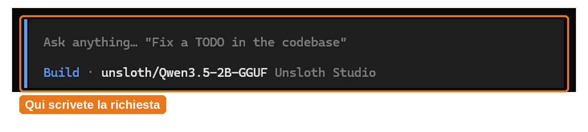
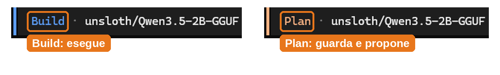

# Slide 01 — Chi controlla che cosa?
<!-- layout: COPERTINA -->

Un agente con più lavori, un modello sul vostro computer e un programma che agisce sui file.

ITS MAKER · 18 novembre 2026 · Microsoft Copilot, Unsloth Studio e opencode

---

# Slide 02 — Riaprite il vostro agente
<!-- layout: CONTENUTO -->

| Dove | Che cosa fate |
| --- | --- |
| Microsoft Copilot | aprite il vostro agente del noleggio, in una nuova conversazione |
| Messaggio | registro, regole del noleggio, e in fondo la richiesta |

> «Per quanti minuti è stata fuori servizio la bici 12 sabato? Mostrami gli orari.»

---

# Slide 03 — Oggi: tre strumenti
<!-- layout: CONTENUTO -->

Microsoft Copilot: il vostro agente con più lavori.

Unsloth Studio: un modello che gira sul vostro computer.

opencode: un programma che lavora sui file.

Da Unsloth Studio in poi lavorate nel computer virtuale: un computer dentro il computer, con il suo Windows. Ognuno ha il suo.

---

# Slide 04 — Il vostro agente ha due parti
<!-- layout: CONTENUTO -->

Aprite il file `istruzioni_agente_noleggio.txt`. Cercate l’elenco delle richieste e i lavori. Un esempio dal testo di partenza, con i tagli segnati […]:

| L’elenco dice | Il lavoro dice |
| --- | --- |
| «Che cosa significa un guasto, che cosa fa il banco → GUASTI» | «Quando: il banco vuole sapere che cosa significa un guasto. […]» |
| «Nota per il turno dopo, riassunto di un giorno, che cosa è successo → PASSAGGIO» | «Quando: serve una nota per chi inizia il turno dopo. […]» |

L’elenco dice a quale lavoro va la richiesta. Il lavoro dice come rispondere.

---

# Slide 05 — Scrivete il lavoro che manca
<!-- layout: CONTENUTO -->

Avete FUORI SERVIZIO e un secondo lavoro. Scrivete quello che manca: GUASTI se avete PASSAGGIO, PASSAGGIO se avete GUASTI. Servono una voce nell’elenco e il lavoro.

| Domanda | Esempio: FUORI SERVIZIO | Il lavoro che manca |
| --- | --- | --- |
| Quando scatta? | «serve la durata di un fuori servizio, i minuti senza bici di un cliente o un rimborso» | per quali richieste? |
| Che testo usa? | «le regole del noleggio e il registro» | quale testo? |
| Come risponde? | «i due orari usati, la sottrazione e il risultato in minuti» | in quale forma? |

---

# Slide 06 — Aggiornate l’agente
<!-- layout: CONTENUTO -->

Salvate il file. Poi in Copilot incollate tutto il testo nelle istruzioni del vostro agente.

Non avete il file? Usate il testo di partenza: ha già i tre lavori.

L’ultima riga del file è anche l’ultima in Copilot?

---

# Slide 07 — Una richiesta per lavoro
<!-- layout: CONTENUTO -->

Una nuova conversazione per ogni richiesta: registro, regole del noleggio, guida ai guasti e in fondo la richiesta.

| Il lavoro | La richiesta |
| --- | --- |
| FUORI SERVIZIO | «Bici 12, sabato: per quanti minuti è stata fuori servizio?» |
| GUASTI | «Che cosa significa freni che non tengono?» |
| PASSAGGIO | «Scrivi la nota per il turno dopo, sabato.» |

---

# Slide 08 — Era il lavoro giusto?
<!-- layout: CONTENUTO -->

Guardate la prima riga di ogni risposta: «Lavoro usato:».

Se il lavoro non è quello giusto, leggete la voce dell’elenco: dice abbastanza chiaramente quando usarlo? Correggetela e riprovate.

---

# Slide 09 — Inventate una richiesta
<!-- layout: CONTENUTO -->

Una richiesta del noleggio che potrebbe andare a due lavori, o a nessuno.

Provatela, in una nuova conversazione con registro, regole e guida. Se va dove non volevate, correggete l’elenco o aggiungete la riga che manca, e riprovate.

---

# Slide 10 — Due lavori in catena
<!-- layout: CONTENUTO -->

Nel vostro elenco deve esserci una riga per FUORI SERVIZIO e PASSAGGIO insieme: prima FUORI SERVIZIO, poi il risultato entra nella nota. Se manca, scrivetela.

Poi inviate, in una nuova conversazione con registro, regole e guida:

> «Bici 12, sabato: per quanti minuti è stata fuori servizio? Scrivi la nota per il turno dopo.»

---

# Slide 11 — Il numero è giusto?
<!-- layout: CONTENUTO -->

## {{MINUTI_FUORI_SERVIZIO}} minuti fuori servizio

{{ORA_FUORI_SERVIZIO}} → {{ORA_DISPONIBILE}}

Il registro dà questi minuti e questi orari per la bici 12, sabato. Nella vostra nota ci sono gli stessi?

---

# Slide 12 — Salvate il file
<!-- layout: CONTENUTO -->

Il file `istruzioni_agente_noleggio.txt` deve contenere tutto: le regole, l’elenco con le vostre correzioni, i tre lavori, lo stile.

Aggiornate l’agente in Copilot e controllate che il testo sia arrivato intero.

---

# Slide 13 — Chi ha controllato il numero?
<!-- layout: CONTENUTO -->

Copilot ha scelto il lavoro e scritto la nota.

Il numero l’avete confrontato voi con il registro. Nessun programma l’ha fatto al vostro posto.

---

# Slide 14 — Un modello sul vostro computer
<!-- layout: SEZIONE -->

Passate al computer virtuale

---

# Slide 15 — Da dove viene il modello?
<!-- layout: CONTENUTO -->

Prima di scaricare un modello, su Hugging Face (un sito pubblico di modelli) si leggono chi l’ha pubblicato, la licenza e quanto pesano i file.

Qui un altro modello, con quattro punti cerchiati.

---

# Slide 16 — Cercate il vostro modello
<!-- layout: CONTENUTO -->

Nel browser del computer virtuale scrivete l’indirizzo:

https://huggingface.co/unsloth/Qwen3.5-2B-GGUF

Trovate le stesse quattro cose: chi l’ha pubblicato, la licenza, il file più piccolo e il più grande. I file sono nell’elenco a destra, sotto «Hardware compatibility».

---

# Slide 17 — Aprite Unsloth Studio
<!-- layout: CONTENUTO -->

Chiudete la pagina di Hugging Face. Doppio clic sul collegamento Unsloth Studio del desktop: si apre il browser. In alto deve esserci il nome del modello, Qwen3.5-2B-GGUF. Se non c’è, scegliete Select model › On Device › Qwen3.5-2B-GGUF e aspettate.

Accanto c’è una finestra nera con del testo che scorre: non chiudetela, o Studio si ferma. Avvisi di aggiornamento: «Remind me later» o «Più tardi».

---

# Slide 18 — Serve Internet?
<!-- layout: CONTENUTO -->

> Per rispondere, questo modello ha bisogno di Internet?

Poi, con il pulsante Nuova chat (o New Chat), scrivete: «In una frase: a che cosa serve un cacciavite?»

---

# Slide 19 — Togliete la rete
<!-- layout: CONTENUTO -->

Togliete la rete al computer virtuale. Poi rifate la stessa domanda, in una nuova chat.

Risponde ancora?

Quando avete la risposta, riattivate la rete: serve a opencode.

---

# Slide 20 — Dove gira?
<!-- layout: CONTENUTO -->

| | Copilot | Studio |
| --- | --- | --- |
| Dove gira il modello | in rete, sui computer di Microsoft | sul vostro computer virtuale |
| Il programma | il codice non si può leggere | il codice è aperto: si può leggere |
| Di chi è | di Microsoft | una copia sul vostro computer: la licenza che avete letto dice che cosa potete farne |

Unsloth Studio è il programma che carica il modello e vi lascia parlarci. Il modello si chiama Qwen3.5-2B: «2B» vuol dire due miliardi di pesi, i numeri che ha imparato.

---

# Slide 21 — I parametri del modello
<!-- layout: CONTENUTO -->

Il pannello si apre con l’icona cerchiata, in alto a destra. Scorretelo: trovate System Prompt, Temperature e Context Length.

Accanto a **Context Length** c’è un numero: quale? È la quantità di testo che il modello riesce a tenere insieme. Non toccatelo. Guardate anche il valore di Temperature: alla fine lo rimettete com’era.

---

# Slide 22 — Stessa domanda, tre risposte
<!-- layout: CONTENUTO -->

> Con Temperature a 1,5, le tre risposte saranno uguali o diverse?

Guardate il proiettore: «Scrivi il nome di una pizza nuova, in poche parole.» Tre volte.

Temperature è un parametro: lo conoscete da Transformer Explainer.

---

# Slide 23 — Provate voi
<!-- layout: CONTENUTO -->

Nuova chat. Temperature a 1,5. Scrivete: «Continua con poche parole: Nel mio laboratorio ho trovato».

Inviate e rigenerate due volte. Confrontate queste tre risposte: quante sono diverse?

---

# Slide 24 — Tre parametri
<!-- layout: CONTENUTO -->

| Parametro | Che cosa fa |
| --- | --- |
| Temperature | più è alta, più il modello sceglie parole poco probabili |
| Top K | il modello sceglie solo tra le K parole più probabili |
| Top P | tiene le parole più probabili finché le loro probabilità, sommate, arrivano a P |

Rimettete Temperature com’era.

---

# Slide 25 — System prompt
<!-- layout: CONTENUTO -->

Il campo **System Prompt** è il testo che il modello legge prima di ogni vostro messaggio. A sinistra un esempio; a destra le domande a cui rispondete voi:

| Domanda | Esempio | Voi |
| --- | --- | --- |
| Che cosa cambia? | il tono | Il tono, la lunghezza o la forma? |
| Che cosa scrivete? | «Sei un cuoco burbero. Rispondi in una frase.» | Le vostre due righe. |
| Che cosa chiedete? | «Quanto ci vuole per una pizza?» | Due domande diverse. |

Il modello segue le vostre istruzioni anche alla seconda domanda?

---

# Slide 26 — Esplorate Studio per conto vostro
<!-- layout: CONTENUTO -->

Scegliete una cosa da provare. Provatela e guardate com’è andata.

| Idea | Che cosa fate |
| --- | --- |
| Un parametro | Temperature, Top K o Top P: la stessa domanda con due valori molto diversi |
| System prompt | un altro ruolo per il modello |
| Hugging Face | un altro modello piccolo: licenza e file |
| Una voce nuova | una voce del pannello delle impostazioni che non abbiamo provato |

Context Length e il modello caricato restano come sono. Non scaricate niente: sono file molto grandi. Non aggiornate e non cancellate niente.

---

# Slide 27 — Chi tocca i file?
<!-- layout: SEZIONE -->

opencode

---

# Slide 28 — Avviate opencode
<!-- layout: CONTENUTO -->

Doppio clic sul collegamento opencode del desktop. Parte nella cartella `laboratorio`, dove ci sono tre file e `opencode.jsonc`, il file con le regole dei permessi: non modificatelo. Il modello è Big Pickle e risponde dalla rete, attraverso il servizio di chi fa opencode: non scrivete dati personali.

---

# Slide 29 — Chi apre i file?
<!-- layout: CONTENUTO -->

> «Che file ci sono in questa cartella e di che cosa parlano?»

Prima di inviare: chi apre i file, il modello o il programma?

Se compare «Permission required» con un comando (un’istruzione per Windows che opencode vuole eseguire), leggete la consegna prima di rispondere.

---

# Slide 30 — Quante letture?
<!-- layout: CONTENUTO -->

Guardate i passaggi: le righe con una freccia, sotto la richiesta, che opencode scrive mentre lavora. Qui sotto, un esempio con un’altra richiesta.

Quante letture ha fatto per la vostra richiesta?

---

# Slide 31 — Una pagina scritta da opencode
<!-- layout: CONTENUTO -->

Un esempio con un altro caso:

> «Crea listino.html con il listino delle pizze in una tabella. Titolo "Le nostre pizze", intestazione rossa.»

Voi: una pagina inventario.html (`.html` = pagina web) con i dati di inventario.csv (`.csv` = tabella di valori separati da virgole). Scegliete voi il titolo, il colore dell’intestazione e una cosa da mettere in evidenza. Scrivete la richiesta nel campo di opencode, senza inviarla.

---

# Slide 32 — Prima in Plan
<!-- layout: CONTENUTO -->

Maiusc+Tab (sullo schermo shift+tab): in basso compare Plan.

> Prima di inviare la richiesta: comparirà il file?

---

# Slide 33 — Ora in Build
<!-- layout: CONTENUTO -->

Maiusc+Tab: in basso torna Build. Inviate di nuovo la stessa richiesta.

---

# Slide 34 — Il programma chiede il permesso
<!-- layout: CONTENUTO -->

Compare «Permission required» per scrivere inventario.html: scegliete **Allow once**. Non scegliete «Always allow».

Se dopo la scrittura chiede un comando, anche quello scritto all’inizio della parte 3: **Reject**. Il file è già scritto.

---

# Slide 35 — Aprite la pagina
<!-- layout: CONTENUTO -->

Esplora file, Documenti › laboratorio: doppio clic su inventario.html.

Contate le righe della tabella con un componente. Poi aprite inventario.csv (tasto destro › Apri con › Blocco note) e contate le righe con un componente. Sono le stesse?

---

# Slide 36 — Dite di no
<!-- layout: CONTENUTO -->

> «Crea riassunto.txt con i punti principali di appunti_riunione.txt.»

Prima di inviare: dopo un Reject, opencode vi darà comunque il riassunto a parole?

Quando compare il permesso, scegliete **Reject**. Non inviate di nuovo la richiesta. Che cosa scrive opencode? Il file c’è?

---

# Slide 37 — Una richiesta vostra
<!-- layout: CONTENUTO -->

Ora decidete voi che cosa chiedere a opencode. Usate due dei file della cartella e fatevi creare un file nuovo.

| Che cosa | Nella pizzeria |
| --- | --- |
| mettere insieme due file | «Leggi listino.txt e ordine.txt e scrivi in conto.txt quanto costa l’ordine.» |
| scegliere e riordinare | «Da listino.txt scrivi in economiche.txt le pizze sotto 8 euro, dalla più cara.» |
| mettere a confronto | «Confronta note_serata.txt e ordine.txt e scrivi in mancanti.txt gli ingredienti che mancano.» |

Scrivete la richiesta nel campo di opencode. Prima di inviare: che cosa deve contenere il nuovo file?

---

# Slide 38 — Controllate il risultato
<!-- layout: CONTENUTO -->

Inviate. Quando compare il permesso, leggete che file vuole scrivere: se è quello che avete chiesto, **Allow once**.

Aprite il file nuovo e confrontatelo con il file originale. Un dato scelto da voi: è uguale? Se non torna, correggete la richiesta e riprovate.

---

# Slide 39 — Dove sono le regole?
<!-- layout: CONTENUTO -->

Nel file `opencode.jsonc` della cartella:

| Dove | Che cosa | Regola | Che cosa fa il programma |
| --- | --- | --- | --- |
| Build | scrivere un file | ask | si ferma e chiede a voi |
| Build e Plan | eseguire un comando | ask | si ferma e chiede a voi |
| Plan | scrivere un file | deny | non esegue |
| sempre | leggere un file | nessuna regola | lo fa senza chiedere: è allow |

Allow once: una volta sola. Always allow: trasforma ask in allow per sempre.

---

# Slide 40 — Chi agisce sui file?
<!-- layout: CONTENUTO -->

> Quale dei tre risponde senza rete? Quale apre i file da solo?

Pensateci, poi guardiamo la tabella.

---

# Slide 41 — La tabella
<!-- layout: CONTENUTO -->

| | Copilot | Studio | opencode |
| --- | --- | --- | --- |
| Dove gira il modello | in rete | sul vostro computer virtuale | in rete |
| Chi apre e scrive i file | nessun programma: voi copiate e incollate | nessun programma: solo la chat | il programma, se glielo permettete |

---

# Slide 42 — Allow, ask o deny?
<!-- layout: CHIUSURA -->

Il modello decide che cosa chiedere. Il programma agisce e chiede il permesso: non controlla che quello che scrive sia giusto.

Un programma come opencode potrebbe anche cancellare un file: allow, ask o deny? Perché? E il contenuto di un file nuovo: chi lo controlla?
