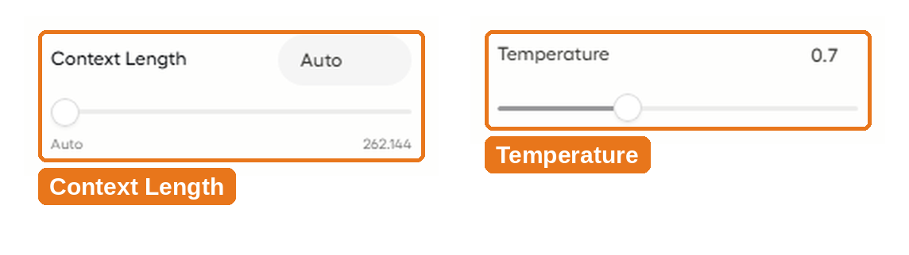

# Slide 01 — Chi decide quale lavoro?
<!-- layout: COPERTINA -->

Un agente che fa il piano, chiede e controlla.

ITS MAKER · 18 novembre 2026 · Microsoft Copilot, Unsloth Studio e opencode

---

# Slide 02 — Riaprite il vostro agente
<!-- layout: CONTENUTO -->

| Dove | Che cosa fate |
| --- | --- |
| Microsoft Copilot | aprite il vostro agente del noleggio, in una nuova conversazione |
| Messaggio | registro, regole del noleggio, e in fondo la richiesta |

> «Per quanti minuti è stata fuori servizio la bici 12 sabato? Mostrami gli orari.»

---

# Slide 03 — Il percorso di oggi
<!-- layout: CONTENUTO -->

| Passo | Dove | Che cosa succede |
| --- | --- | --- |
| 1 | Copilot | al vostro testo aggiungete il piano, il rimborso e il controllo |
| 2 | Unsloth Studio | un modello nel computer virtuale: serve la rete? |
| 3 | opencode | un programma accanto ai file: chi li apre? |

Le ultime due domande le risolvete provando. Dal passo 2 lavorate nel computer virtuale: un computer dentro il computer, con il suo Windows e i suoi programmi. Ognuno ha il suo.

---

# Slide 04 — Due lavori insieme: piano o risposta?
<!-- layout: CONTENUTO -->

> Chiedete due cose insieme all’agente. Volete vedere subito la risposta, o prima il piano?

Alzata di mano.

Nell’agente della lezione 4 Copilot segue l’elenco e risponde subito. Se sbaglia, lo scoprite dopo.

---

# Slide 05 — Il piano prima della risposta
<!-- layout: CONTENUTO -->

Una regola nelle istruzioni della pizzeria (estratto):

> «Se la richiesta ha due o più lavori, scrivi prima "Piano:" con i lavori nell’ordine in cui li usi e i dati che mancano. Poi fermati e aspetta la parola "Procedi".»

La richiesta: «La pizza è arrivata fredda e voglio i soldi indietro.»

Prima di vedere la risposta, per alzata di mano: l’agente si ferma dopo il piano?

---

# Slide 06 — Il piano si può correggere
<!-- layout: CONTENUTO -->

La risposta al piano: «Procedi, ma solo il reclamo.»

Che cosa deve fare adesso l’agente? Che cosa non deve fare?

---

# Slide 07 — Scrivete la regola del piano
<!-- layout: CONTENUTO -->

| Domanda | Pizzeria | Noleggio: voi |
| --- | --- | --- |
| Quando scatta? | «due o più lavori» | per quali richieste? |
| Che cosa contiene? | lavori in ordine, dati che mancano | e i testi che userà? |
| Dove si ferma? | dopo il piano | qual è il segno? |
| Che parola lo fa ripartire? | «Procedi» | la scegliete voi |
| E «Lavoro usato:»? | dopo il piano | il piano viene prima: correggete la regola della prima riga |

Aggiungete la regola alle **regole per tutti i casi**, nel file `istruzioni_agente_noleggio.txt`. Poi aggiornate l’agente in Copilot.

---

# Slide 08 — Provate: due lavori insieme
<!-- layout: CONTENUTO -->

Una nuova conversazione. Registro, regole del noleggio e in fondo la richiesta. Con GUASTI aggiungete anche la guida ai guasti. Siete partiti dalle istruzioni di partenza? Scegliete voi GUASTI o PASSAGGIO.

| Il vostro secondo lavoro | Richiesta |
| --- | --- |
| GUASTI | «Bici 12, sabato: quanto è stata fuori servizio, e che cosa significa freni che non tengono?» |
| PASSAGGIO | «Bici 12, sabato: quanto è stata fuori servizio? Scrivi la nota per il turno dopo.» |

Prima di inviare: che piano vi aspettate?

---

# Slide 09 — Il piano era giusto?
<!-- layout: CONTENUTO -->

| Controllate | Sì / No |
| --- | --- |
| il piano viene prima di qualsiasi risposta ai lavori | |
| i due lavori sono nell’ordine che avevate deciso | |
| dice quali testi userà | |
| si ferma e aspetta | |
| dopo «Procedi» risponde | |

Una prova riuscita al primo invio vale quanto una riuscita dopo una correzione.

---

# Slide 10 — Il rimborso è un lavoro a sé
<!-- layout: CONTENUTO -->

Dopo il fuori servizio, il titolare chiede anche: «E quanto dobbiamo rimborsare al cliente?»

Il rimborso conta altri minuti: quelli del cliente senza bici, dalla segnalazione al cambio. E ha bisogno di un dato che il registro non ha: il tipo di noleggio.

Quando una richiesta cresce, le si dà un lavoro a sé.

---

# Slide 11 — Scrivete il lavoro RIMBORSO
<!-- layout: CONTENUTO -->

| Riga | Pizzeria, lavoro RIMBORSO (in breve) | Voi, lavoro RIMBORSO |
| --- | --- | --- |
| Quando si usa | «il cliente chiede soldi indietro» | per quali richieste? |
| Dati che servono | «numero dell’ordine, importo pagato, motivo» | quali minuti? quale tariffa? |
| Regole del lavoro | «pizza non arrivata: proposta di rimborso intero» | da quando a quando contano i minuti? |
| Come risponde | «PROPOSTA DA CONTROLLARE, l’importo e il calcolo» | che cosa mostra? E se manca un dato? |

Se il rimborso è dentro FUORI SERVIZIO, toglietelo da lì. Il banco decide: l’agente propone.

---

# Slide 12 — Quale lavoro va prima?
<!-- layout: CONTENUTO -->

Aggiornate l’elenco delle richieste.

FUORI SERVIZIO e RIMBORSO insieme: quale va prima? Quali orari usa ciascuno dei due?

---

# Slide 13 — Ogni numero, la sua riga
<!-- layout: CONTENUTO -->

Una regola nelle istruzioni della pizzeria (estratto):

> «In fondo alla risposta scrivi "Controllo:" e, per ogni numero della risposta, la riga delle istruzioni da cui viene. Se non la trovi, scrivi "Non trovato".»

La richiesta: «Quanto costa una Diavola con la consegna?»

Dove cercate la riga, per controllare il controllo?

---

# Slide 14 — Scrivete la regola del controllo
<!-- layout: CONTENUTO -->

| Domanda | Pizzeria | Noleggio: voi |
| --- | --- | --- |
| Che cosa controlla? | «ogni numero della risposta» | solo i numeri, o anche gli orari? |
| Che cosa scrive? | «la riga delle istruzioni» | quale testo? con quale data e ora? |
| E se non trova la riga? | «Non trovato» | che cosa fa? |

Aggiungete la regola alle regole per tutti i casi.

---

# Slide 15 — Tre lavori in una richiesta
<!-- layout: CONTENUTO -->

| Il vostro secondo lavoro | Richiesta |
| --- | --- |
| GUASTI | «Bici 12, sabato: quanto è stata fuori servizio, che cosa significa freni che non tengono, quanto rimborsiamo al cliente?» |
| PASSAGGIO | «Bici 12, sabato: quanto è stata fuori servizio, quanto rimborsiamo al cliente? Prepara la nota per il turno dopo.» |

Una sola prova per le due regole nuove. Aggiornate l’agente. Poi una nuova conversazione, i testi che servono, la richiesta in fondo. Prima di inviare: che dato vi aspettate che chieda?

---

# Slide 16 — Ha chiesto il tipo di noleggio?
<!-- layout: CONTENUTO -->

Quando l’agente chiede il tipo di noleggio, rispondete: «A ore. Procedi.»

Se chiede anche il turno: «La nota è per chi inizia il pomeriggio di sabato.»

Se non lo chiede, guardate che tipo di noleggio ha scelto.

---

# Slide 17 — Gli orari devono tornare
<!-- layout: CONTENUTO -->

## {{MINUTI_SENZA_BICI}} minuti senza bici

{{ORA_SEGNALAZIONE}} → {{ORA_CAMBIO}}

| Tipo di noleggio | Rimborso proposto |
| --- | --- |
| a ore | {{RIMBORSO_A_ORE}} euro |
| giornata intera | {{RIMBORSO_GIORNATA}} euro |

Il rimborso non usa i {{MINUTI_FUORI_SERVIZIO}} minuti di fuori servizio della bici. Con «a ore» il numero giusto è il primo. Se l’agente ha scelto da solo il tipo di noleggio, correggete la regola del RIMBORSO.

---

# Slide 18 — Controllate il controllo
<!-- layout: CONTENUTO -->

Nella risposta alla richiesta a tre lavori scegliete un numero e cercate nel registro o nelle regole del noleggio la riga che l’agente cita.

> La riga esiste davvero? Dice quello che l’agente dice?

Un controllo che cita una riga inventata è peggio di nessun controllo.

---

# Slide 19 — Una richiesta vostra
<!-- layout: CONTENUTO -->

Inventate una richiesta per il noleggio.

| Tipo di richiesta | Nella pizzeria |
| --- | --- |
| un dato che manca | «Vorrei due pizze per stasera.» (quali? a che ora?) |
| un testo che non basta | «Quanto costa una birra?» (il listino non la dice) |
| un lavoro che l’agente non ha | «Mi prenoti un tavolo per sabato?» |

Scegliete un tipo. Scrivete su un foglio la risposta corretta. Poi provate, in una nuova conversazione. Se funziona subito, cercate la regola che lo ha reso possibile. Se qualcosa non va, correggete il punto necessario e riprovate.

---

# Slide 20 — Salvate il file
<!-- layout: CONTENUTO -->

Il file `istruzioni_agente_noleggio.txt` deve contenere tutto: regole per tutti i casi con piano e controllo, i tre o quattro lavori, l’elenco delle richieste, lo stile.

Aggiornate l’agente in Copilot e controllate che il testo sia arrivato intero.

---

# Slide 21 — Chi ha fatto che cosa?
<!-- layout: CONTENUTO -->

> Scegliere i lavori, decidere l’ordine, fermarsi a chiedere, controllare. Questo lavoro ha un nome: coordinare.

Il vostro agente ha un coordinatore. Dove sta?

---

# Slide 22 — Un modello sul vostro computer
<!-- layout: SEZIONE -->

Passate al computer virtuale

---

# Slide 23 — Aprite Unsloth Studio
<!-- layout: CONTENUTO -->

Doppio clic sul collegamento Unsloth Studio del desktop: si apre il browser. In alto deve esserci il nome del modello, Qwen3.5-2B-GGUF. Se non c’è, scegliete Select model › On Device › Qwen3.5-2B-GGUF e aspettate.

Accanto c’è una finestra nera con del testo che scorre: non chiudetela, o Studio si ferma.

---

# Slide 24 — Serve Internet?
<!-- layout: CONTENUTO -->

> Per rispondere, questo modello ha bisogno di Internet?

Alzata di mano: sì o no.

Poi, con il pulsante Nuova chat, scrivete: «In una frase: a che cosa serve un cacciavite?»

---

# Slide 25 — Togliete la rete
<!-- layout: CONTENUTO -->

Togliete la rete al computer virtuale: il docente vi fa vedere come. Poi rifate la stessa domanda, in una nuova chat.

Risponde ancora?

Quando avete la risposta, riattivate la rete: serve a opencode.

---

# Slide 26 — Dove gira?
<!-- layout: CONTENUTO -->

| | Copilot | il modello di Studio |
| --- | --- | --- |
| Dove gira | in rete, sui computer di Microsoft | sul vostro computer virtuale |
| Il codice | non si può leggere | aperto: si può leggere |
| Di chi è | di Microsoft | vostro: è un file sul vostro computer |

Unsloth Studio è il programma che carica il modello e vi lascia parlarci. Il modello si chiama Qwen3.5-2B: «2B» vuol dire due miliardi di pesi, i numeri che ha imparato.

---

# Slide 27 — Le manopole del modello
<!-- layout: CONTENUTO -->

Il pannello si apre con l’icona cerchiata, in alto a destra. Scorretelo: trovate System Prompt, Temperature, Top P, Top K e Context Length.

Accanto a **Context Length** c’è un numero: quale? È la quantità di testo che il modello riesce a tenere insieme. Non toccatelo. Guardate anche il valore di Temperature: alla fine lo rimettete com’era.

---

# Slide 28 — Stessa domanda, tre risposte
<!-- layout: CONTENUTO -->

> Con Temperature a 1,5, le tre risposte saranno uguali o diverse?

Alzata di mano. Poi guardate il proiettore: «Scrivi il nome di una pizza nuova, in poche parole.» Tre volte.

Temperature è la manopola di Transformer Explainer.

---

# Slide 29 — Provate voi
<!-- layout: CONTENUTO -->

Nuova chat. Temperature a 1,5. Scrivete: «Continua con poche parole: Nel mio laboratorio ho trovato».

Inviate e rigenerate due volte. Confrontate queste tre risposte: quante sono diverse?

---

# Slide 30 — Top K a 1
<!-- layout: CONTENUTO -->

> Temperature resta a 1,5. Con Top K a 1, le tre risposte saranno uguali o diverse?

Alzata di mano. Poi guardate il proiettore: la pizza, tre volte.

---

# Slide 31 — Top P a 0,1
<!-- layout: CONTENUTO -->

> Con Top P a 0,1, le risposte saranno uguali o diverse?

Alzata di mano. Poi guardate il proiettore: la pizza, tre volte.

---

# Slide 32 — Tre manopole
<!-- layout: CONTENUTO -->

| Manopola | Che cosa fa |
| --- | --- |
| Temperature | più è alta, più il modello sceglie parole poco probabili |
| Top K | il modello sceglie solo tra le K parole più probabili: con 1, sempre la prima |
| Top P | tiene le parole più probabili finché, sommate, arrivano a P: con 0,1 (cioè 10%) di solito resta la prima |

Rimettete Temperature com’era.

---

# Slide 33 — Le istruzioni di sistema
<!-- layout: CONTENUTO -->

Il campo **System Prompt** è il testo che il modello legge prima di ogni vostro messaggio. A sinistra un esempio; a destra le domande a cui rispondete voi:

| Domanda | Esempio | Voi |
| --- | --- | --- |
| Che cosa cambia? | il tono | Il tono, la lunghezza o la forma? |
| Che cosa scrivete? | «Sei un cuoco burbero. Rispondi in una frase.» | Le vostre due righe. |
| Che cosa chiedete? | «Quanto ci vuole per una pizza?» | Due domande diverse. |

Il modello segue le vostre istruzioni anche alla seconda domanda?

---

# Slide 34 — Chi tocca i file?
<!-- layout: SEZIONE -->

opencode

---

# Slide 35 — Avviate opencode
<!-- layout: CONTENUTO -->

Doppio clic sul collegamento opencode del desktop. Parte nella cartella `laboratorio`, dove ci sono tre file e `opencode.jsonc`, il file con le regole dei permessi: non modificatelo. Il modello è Big Pickle e risponde dalla rete, attraverso il servizio di chi fa opencode: non scrivete dati personali.

---

# Slide 36 — Chi apre i file?
<!-- layout: CONTENUTO -->

> «Che file ci sono in questa cartella e di che cosa parlano?»

Prima di inviare, alzata di mano: chi apre i file, il modello o il programma?

Se compare «Permission required» con un comando (un’istruzione per Windows che opencode vuole eseguire), leggete la consegna prima di rispondere.

---

# Slide 37 — Quante letture?
<!-- layout: CONTENUTO -->

Guardate i passaggi: le righe con una freccia, sotto la richiesta, che opencode scrive mentre lavora. Qui sotto, un esempio con un’altra richiesta.

Quante letture ha fatto per la vostra richiesta?

---

# Slide 38 — Una pagina scritta da opencode
<!-- layout: CONTENUTO -->

Un esempio con un altro caso:

> «Crea listino.html con il listino delle pizze in una tabella. Titolo "Le nostre pizze", intestazione rossa.»

Voi: una pagina inventario.html (`.html` = pagina web) con i dati di inventario.csv (`.csv` = tabella di valori separati da virgole). Scegliete voi il titolo, il colore dell’intestazione e una cosa da mettere in evidenza. Scrivete la richiesta nel campo di opencode, senza inviarla.

---

# Slide 39 — Prima in Plan
<!-- layout: CONTENUTO -->

Maiusc+Tab (sullo schermo shift+tab): in basso compare Plan. Inviate la richiesta.

> Comparirà il file?

---

# Slide 40 — Ora in Build
<!-- layout: CONTENUTO -->

Maiusc+Tab: in basso torna Build. Inviate di nuovo la stessa richiesta.

---

# Slide 41 — Il programma chiede il permesso
<!-- layout: CONTENUTO -->

Compare «Permission required»: il programma si ferma e chiede a voi.

Scegliete **Allow once**: approvate questa volta. Non scegliete «Always allow».

---

# Slide 42 — Aprite la pagina
<!-- layout: CONTENUTO -->

Esplora file, Documenti › laboratorio: doppio clic su inventario.html.

Contate le righe della tabella con un componente. Poi aprite inventario.csv (tasto destro › Apri con › Blocco note) e contate le righe con un componente. Sono le stesse?

---

# Slide 43 — Dite di no
<!-- layout: CONTENUTO -->

> «Crea riassunto.txt con i punti principali di appunti_riunione.txt.»

Prima di inviare: dopo un Reject, opencode vi darà comunque il riassunto a parole?

Quando compare il permesso, scegliete **Reject**. Che cosa scrive opencode? Il file c’è?

---

# Slide 44 — Dove sono le regole?
<!-- layout: CONTENUTO -->

Nel file `opencode.jsonc` della cartella:

| Dove | Che cosa | Regola | Che cosa fa il programma |
| --- | --- | --- | --- |
| Build | scrivere un file | ask | si ferma e chiede a voi |
| Build e Plan | eseguire un comando | ask | si ferma e chiede a voi |
| Plan | scrivere un file | deny | non esegue |
| sempre | leggere un file | nessuna regola | lo fa senza chiedere: è allow |

Allow once: una volta sola. Always allow: trasforma ask in allow per sempre.

---

# Slide 45 — Chi agisce sui file?
<!-- layout: CONTENUTO -->

> Quale dei tre risponde senza rete? Quale apre i file da solo?

Pensateci, poi guardiamo la tabella.

---

# Slide 46 — La tabella
<!-- layout: CONTENUTO -->

| | Copilot | Studio | opencode |
| --- | --- | --- | --- |
| Dove gira il modello | in rete | sul vostro computer | in rete |
| Chi apre e scrive i file | nessun programma: voi copiate e incollate | nessun programma: solo la chat | il programma, se glielo permettete |

---

# Slide 47 — Allow, ask o deny?
<!-- layout: CHIUSURA -->

Il modello decide che cosa chiedere. Il programma agisce e chiede il permesso.

Un programma come opencode potrebbe anche cancellare un file: allow, ask o deny? Perché?
