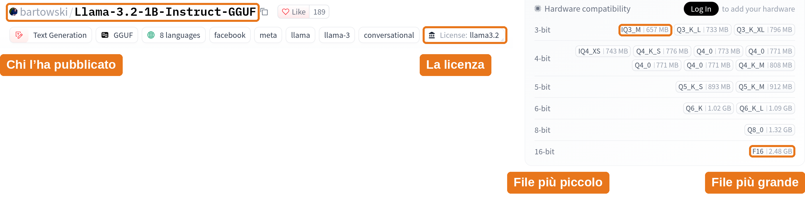
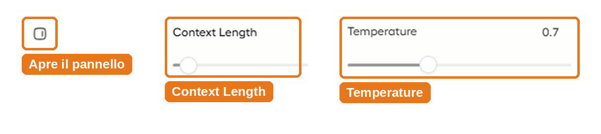
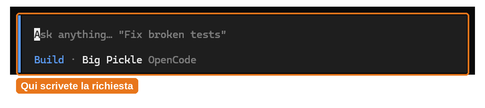
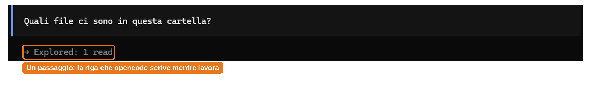
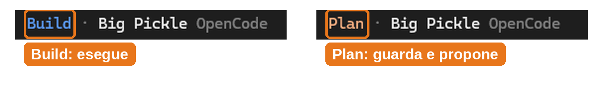

# Slide 01 — Chi controlla che cosa?
<!-- layout: COPERTINA -->

Oggi un agente sceglie tra più lavori, un modello risponde dal vostro computer e un programma scrive dei file. Ogni volta vi chiedete: chi ha controllato?

ITS MAKER · 19 novembre 2026 · Microsoft Copilot, Unsloth Studio e opencode

---

# Slide 02 — Il titolare vuole tre lavori
<!-- layout: CONTENUTO -->

Il titolare di Ruota Libera ha provato il vostro agente. Vuole che sappia fare tutti e tre i lavori: fuori servizio, guasti e passaggio di turno.

In Microsoft Copilot lo completate e controllate che scelga il lavoro giusto.

Poi passate al computer virtuale: un secondo Windows, dentro una finestra del vostro computer. Ognuno ha il suo. Lì provate Unsloth Studio, che fa girare un modello sul vostro computer, e opencode, che legge e scrive i file di una cartella.

---

# Slide 03 — Riaprite il vostro agente
<!-- layout: CONTENUTO -->

Aprite Microsoft Copilot e il vostro agente, in una nuova conversazione. Nel messaggio incollate il registro, poi le regole del noleggio e in fondo questa richiesta:

> «Per quanti minuti è stata fuori servizio la bici 12 sabato? Mostrami gli orari.»

Cercate nel registro quando la bici 12 viene tolta e quando torna disponibile: sono gli orari della risposta?

---

# Slide 04 — Trovate nel vostro file l’elenco e i lavori
<!-- layout: CONTENUTO -->

Aprite in Blocco note `istruzioni_agente_noleggio.txt`. Non avete il file? Chiedete il testo di partenza.

Ecco FUORI SERVIZIO nel testo di partenza (i tagli sono segnati con […]); nel vostro file le parole possono cambiare:

| L’elenco dice | Il lavoro dice |
| --- | --- |
| «Quanto è stata fuori servizio una bici, minuti senza bici, rimborso per un guasto → FUORI SERVIZIO» | «Quando: serve la durata di un fuori servizio, i minuti senza bici di un cliente o un rimborso. […]» |

L’elenco sceglie il lavoro. Il lavoro dice quando serve, quale testo usare e come rispondere.

---

# Slide 05 — Scrivete il lavoro che manca
<!-- layout: CONTENUTO -->

Scrivete il lavoro che manca, GUASTI o PASSAGGIO: una voce nell’elenco e il lavoro. Al centro l’esempio, a destra le domande.

| Che cosa scrivete | Esempio: FUORI SERVIZIO | Il lavoro che manca |
| --- | --- | --- |
| Voce nell’elenco | «Quanto è stata fuori servizio una bici, […] → FUORI SERVIZIO» | Quali parole della richiesta la fanno scegliere? |
| Quando serve? | «serve la durata di un fuori servizio, i minuti senza bici di un cliente […]» | Che cosa serve a chi chiede? |
| Che testo usa? | «le regole del noleggio e il registro» | Quale testo? |
| Come risponde? | «i due orari usati, la sottrazione e il risultato in minuti» | In quale forma? |

---

# Slide 06 — Aggiornate l’agente
<!-- layout: CONTENUTO -->

Salvate il file. Nelle istruzioni del vostro agente, in Copilot, cancellate il testo vecchio, incollate tutto il file e salvate l’agente.

Poi controllate che l’ultima riga sia la stessa nel file e in Copilot: se coincide, il testo è entrato tutto.

---

# Slide 07 — Una richiesta per lavoro
<!-- layout: CONTENUTO -->

Ora provate l’agente con tre richieste, una per ogni lavoro. Per ognuna aprite una nuova conversazione e incollate registro, regole del noleggio e guida ai guasti, con la richiesta in fondo. Se l’agente vi fa una domanda, rispondete nella stessa conversazione.

> «Bici 12, sabato: per quanti minuti è rimasto senza bici il cliente?»

> «Che cosa significa freni che non tengono?»

> «Scrivi la nota per il turno dopo, sabato.»

---

# Slide 08 — Era il lavoro giusto?
<!-- layout: CONTENUTO -->

Il vostro agente scrive «Lavoro usato:» nella prima riga di ogni risposta. Era il lavoro giusto? La risposta contiene ciò che dice la tabella?

| Richiesta | Lavoro atteso | Che cosa c’è nella risposta |
| --- | --- | --- |
| Minuti senza bici del cliente | FUORI SERVIZIO | segnalazione del guasto, consegna della nuova bici, minuti |
| Freni che non tengono | GUASTI | le parole della guida |
| Nota del turno | PASSAGGIO | i titoli scritti nel vostro PASSAGGIO e gli orari del registro |

Lavoro sbagliato? Correggete la voce dell’elenco. Risposta sbagliata? Correggete il lavoro. Poi aggiornate l’agente e riprovate.

---

# Slide 09 — Dove sono finiti i dati?
<!-- layout: CONTENUTO -->

In Copilot avete incollato un registro inventato.

> Se fosse stato il registro vero di un’azienda, dove sarebbero finiti quei dati?

Rispondete a voce. Più avanti vi farete la stessa domanda per Studio e per opencode.

---

# Slide 10 — Due lavori in catena
<!-- layout: CONTENUTO -->

A una richiesta possono servire due lavori di seguito: FUORI SERVIZIO calcola i minuti, poi PASSAGGIO li mette nella nota per il turno dopo. Quale voce del vostro elenco dice questo ordine? Non c’è? Scrivetela e aggiornate l’agente.

Poi inviate, in una nuova conversazione come per le altre richieste:

> «Bici 12, sabato: per quanti minuti è stata fuori servizio? Scrivi la nota per il turno dopo.»

---

# Slide 11 — Il numero è giusto?
<!-- layout: CONTENUTO -->

Il calcolo dal registro dà:

## {{MINUTI_FUORI_SERVIZIO}} minuti fuori servizio

{{ORA_FUORI_SERVIZIO}} → {{ORA_DISPONIBILE}}

La sottrazione, nella vostra risposta, usa questi due orari? La nota riporta lo stesso numero? Se tutto torna, va bene così. Se no, dove è sbagliato?

| Dove è sbagliato | Che cosa correggete |
| --- | --- |
| già nella sottrazione | il lavoro FUORI SERVIZIO |
| solo nella nota | la voce dei due lavori insieme |

---

# Slide 12 — Salvate il file
<!-- layout: CONTENUTO -->

Controllate che il file `istruzioni_agente_noleggio.txt` abbia: le regole per tutti i casi, l’elenco delle richieste con le vostre correzioni, i tre lavori e lo stile.

Studio e opencode usano altri testi, ma salvatelo: serve anche nelle prossime lezioni.

---

# Slide 13 — Chi ha controllato il numero?
<!-- layout: CONTENUTO -->

Copilot ha scelto il lavoro e ha scritto la nota. E il numero: chi l’ha confrontato con il registro?

Nel testo di partenza la voce «PASSAGGIO e FUORI SERVIZIO insieme: prima FUORI SERVIZIO, poi il risultato entra nella nota di PASSAGGIO» dice quale lavoro usare, in che ordine e che cosa passa dall’uno all’altro. Un elenco così si chiama orchestratore: sceglie e passa il numero, non lo controlla.

---

# Slide 14 — Un modello sul vostro computer
<!-- layout: SEZIONE -->

Passate al computer virtuale

---

# Slide 15 — Da dove viene il modello?
<!-- layout: CONTENUTO -->

Prima di scaricare un modello, su Hugging Face (un sito pubblico di modelli) si leggono chi l’ha pubblicato, la licenza e quanto pesano i file.

Qui un altro modello, con quattro punti cerchiati.

---

# Slide 16 — Cercate il vostro modello
<!-- layout: CONTENUTO -->

Nel browser del computer virtuale scrivete l’indirizzo:

https://huggingface.co/unsloth/Qwen3.5-2B-GGUF

Trovate le stesse quattro cose: chi l’ha pubblicato, la licenza, il file più piccolo e il più grande. I file sono nell’elenco a destra, sotto «Hardware compatibility».

---

# Slide 17 — Aprite Unsloth Studio
<!-- layout: CONTENUTO -->

Chiudete la pagina di Hugging Face. Doppio clic sul collegamento Unsloth Studio del desktop: si apre il browser. In alto deve esserci il nome del modello, Qwen3.5-2B-GGUF. Se non c’è, scegliete Select model › On Device › Qwen3.5-2B-GGUF e aspettate.

Accanto c’è una finestra nera con del testo che scorre: non chiudetela, o Studio si ferma. Avvisi di aggiornamento: «Remind me later» o «Più tardi».

---

# Slide 18 — Serve Internet?
<!-- layout: CONTENUTO -->

> Per rispondere, questo modello ha bisogno di Internet?

Poi, con il pulsante Nuova chat (o New Chat), scrivete: «In una frase: a che cosa serve un cacciavite?»

---

# Slide 19 — Togliete la rete
<!-- layout: CONTENUTO -->

Togliete la rete al computer virtuale. Poi rifate la stessa domanda, in una nuova chat.

Risponde ancora?

Quando avete la risposta, riattivate la rete: serve a opencode.

---

# Slide 20 — Dove gira?
<!-- layout: CONTENUTO -->

| | Copilot | Studio |
| --- | --- | --- |
| Dove gira il modello | in rete, sui computer di Microsoft | sul vostro computer virtuale |
| Il programma | il codice non si può leggere | il codice è aperto: si può leggere |
| Dove vanno i dati che scrivete | in rete, al servizio di Microsoft | il modello li legge sul vostro computer, anche senza rete |
| Di chi è | di Microsoft | una copia sul vostro computer, con la sua licenza |

Qwen3.5-2B ha due miliardi di pesi e gira sul vostro processore: per questo può rispondere piano.

Sul proiettore: Copilot risponde alla domanda del cacciavite. Che cosa cambia?

---

# Slide 21 — I parametri del modello
<!-- layout: CONTENUTO -->

Il pannello si apre con l’icona cerchiata, in alto a destra. Scorretelo: trovate System Prompt, Temperature e Context Length.

Accanto a **Context Length** c’è un numero: quale? È la quantità di testo che il modello riesce a tenere insieme. Non toccatelo. Guardate anche il valore di Temperature: alla fine lo rimettete com’era.

---

# Slide 22 — Stessa domanda, tre risposte
<!-- layout: CONTENUTO -->

> Con Temperature a 1,5, le tre risposte saranno uguali o diverse?

Guardate il proiettore: «Scrivi il nome di una pizza nuova, in poche parole.» Tre volte.

Temperature è un parametro: lo conoscete da Transformer Explainer.

---

# Slide 23 — Provate voi
<!-- layout: CONTENUTO -->

Nuova chat. Temperature a 1,5. Scrivete: «Continua con poche parole: Nel mio laboratorio ho trovato».

Inviate e rigenerate due volte. Confrontate queste tre risposte: quante sono diverse?

---

# Slide 24 — Tre parametri
<!-- layout: CONTENUTO -->

| Parametro | Che cosa fa |
| --- | --- |
| Temperature | più è alta, più il modello sceglie parole poco probabili |
| Top K | il modello sceglie solo tra le K parole più probabili |
| Top P | tiene le parole più probabili finché le loro probabilità, sommate, arrivano a P |

Rimettete Temperature com’era.

---

# Slide 25 — System prompt
<!-- layout: CONTENUTO -->

Il campo **System Prompt** è il testo che il modello legge prima di ogni vostro messaggio. A sinistra un esempio; a destra le domande a cui rispondete voi:

| Domanda | Esempio | Voi |
| --- | --- | --- |
| Che cosa cambia? | il tono | Il tono, la lunghezza o la forma? |
| Che cosa scrivete? | «Sei un cuoco burbero. Rispondi in una frase.» | Le vostre due righe. |
| Che cosa chiedete? | «Quanto ci vuole per una pizza?» | Due domande diverse. |

Il modello segue le vostre istruzioni anche alla seconda domanda?

---

# Slide 26 — Quanto testo tiene insieme il modello?
<!-- layout: CONTENUTO -->

Il Context Length della vostra copia di Studio è 8192. Si misura in token, pezzetti di parola. Registro, regole e istruzioni del noleggio, insieme, ne occupano circa 3.700.

> Il messaggio supera 8192: che cosa farà Studio?

Pensateci, poi guardate il proiettore: un testo lungo e una domanda su una frase che sta all’inizio.

---

# Slide 27 — opencode non è il solo
<!-- layout: CONTENUTO -->

Conoscete qualcuno di questi programmi? Lavorano sui file, come opencode.

| Programma | Chi lo fa | Il codice è aperto? |
| --- | --- | --- |
| Claude Code | Anthropic | no |
| Codex CLI | OpenAI | sì |
| Gemini CLI | Google | sì |
| GitHub Copilot CLI | GitHub (Microsoft) | no |
| opencode | Anomaly | sì |

CLI, nel nome, vuol dire che si usano scrivendo in una finestra nera. Noi usiamo opencode: il codice è aperto e funziona con molti modelli.

---

# Slide 28 — Avviate opencode
<!-- layout: CONTENUTO -->

Doppio clic sul collegamento opencode del desktop. Parte nella cartella `laboratorio`, dove ci sono tre file e `opencode.jsonc`, il file con le regole dei permessi: non modificatelo. Il modello è Big Pickle e risponde dalla rete, attraverso il servizio di chi fa opencode: non scrivete dati personali.

---

# Slide 29 — Chi apre i file?
<!-- layout: CONTENUTO -->

> «Che file ci sono in questa cartella e di che cosa parlano?»

Prima di inviare: chi apre i file, il modello o il programma?

Se compare «Permission required» con un comando (un’istruzione per Windows che opencode vuole eseguire), leggete la consegna prima di rispondere.

---

# Slide 30 — Quante letture?
<!-- layout: CONTENUTO -->

Guardate i passaggi: le righe con una freccia, sotto la richiesta, che opencode scrive mentre lavora. Qui sotto, un esempio con un’altra richiesta.

Quante letture ha fatto per la vostra richiesta?

---

# Slide 31 — Una pagina scritta da opencode
<!-- layout: CONTENUTO -->

Un esempio con un altro caso:

> «Crea listino.html con il listino delle pizze in una tabella. Titolo "Le nostre pizze", intestazione rossa.»

Voi: una pagina inventario.html (`.html` = pagina web) con i dati di inventario.csv (`.csv` = tabella di valori separati da virgole). Scegliete voi il titolo, il colore dell’intestazione e una cosa da mettere in evidenza. Scrivete la richiesta nel campo di opencode, senza inviarla.

---

# Slide 32 — Prima in Plan
<!-- layout: CONTENUTO -->

Maiusc+Tab (sullo schermo shift+tab): in basso compare Plan.

> Prima di inviare: comparirà il file? Poi inviate la richiesta.

---

# Slide 33 — Ora in Build
<!-- layout: CONTENUTO -->

Maiusc+Tab: in basso torna Build. Riscrivete la stessa richiesta e inviatela.

---

# Slide 34 — Il programma chiede il permesso
<!-- layout: CONTENUTO -->

Compare «Permission required» per scrivere inventario.html. Prima di scegliere, leggete il nome del file e il testo che vuole scrivere: c’è il titolo che avete scelto? Poi **Allow once**. Non scegliete «Always allow».

Se dopo la scrittura chiede un comando, anche quello scritto all’inizio della parte 3: **Reject**. Il file è già scritto.

---

# Slide 35 — Aprite la pagina
<!-- layout: CONTENUTO -->

Esplora file, Documenti › laboratorio: doppio clic su inventario.html.

Contate le righe della tabella con un componente. Poi aprite inventario.csv (tasto destro › Apri con › Blocco note) e contate le righe con un componente. Sono le stesse?

---

# Slide 36 — Dite di no
<!-- layout: CONTENUTO -->

> «Crea riassunto.txt con i punti principali di appunti_riunione.txt.»

Prima di inviare: dopo un Reject, opencode vi darà comunque il riassunto a parole?

Quando compare il permesso, scegliete **Reject**. Non inviate di nuovo la richiesta. Che cosa scrive opencode? Il file c’è?

---

# Slide 37 — Una richiesta vostra
<!-- layout: CONTENUTO -->

Ora decidete voi che cosa chiedere a opencode. Usate due dei file della cartella e fatevi creare un file nuovo.

| Che cosa | Nella pizzeria |
| --- | --- |
| mettere insieme due file | «Leggi listino.txt e ordine.txt e scrivi in conto.txt quanto costa l’ordine.» |
| scegliere e riordinare | «Da listino.txt scrivi in economiche.txt le pizze sotto 8 euro, dalla più cara.» |
| mettere a confronto | «Confronta note_serata.txt e ordine.txt e scrivi in mancanti.txt gli ingredienti che mancano.» |

Scrivete la richiesta nel campo di opencode. Prima di inviare: che cosa deve contenere il nuovo file?

---

# Slide 38 — Controllate il risultato
<!-- layout: CONTENUTO -->

Inviate. Quando compare il permesso, leggete il nome del file e il testo che vuole scrivere: c’è il dato che avete previsto? Poi **Allow once**.

Aprite il file nuovo e confrontatelo con il file originale. Un dato scelto da voi: è uguale? Se non torna, correggete la richiesta e riprovate.

---

# Slide 39 — Dove sono le regole?
<!-- layout: CONTENUTO -->

Nel file `opencode.jsonc` della cartella:

| Dove | Che cosa | Regola | Che cosa fa il programma |
| --- | --- | --- | --- |
| Build | scrivere un file | ask | si ferma e chiede a voi |
| Build e Plan | eseguire un comando | ask | si ferma e chiede a voi |
| Plan | scrivere un file | deny | non esegue |
| sempre | leggere un file | nessuna regola | lo fa senza chiedere: è allow |

Allow once: una volta sola. Always allow: trasforma ask in allow per sempre.

---

# Slide 40 — Chi agisce sui file?
<!-- layout: CONTENUTO -->

> Quale dei tre risponde senza rete? Quale apre i file da solo?

Pensateci, poi guardiamo la tabella.

---

# Slide 41 — La tabella
<!-- layout: CONTENUTO -->

| | Copilot | Studio | opencode |
| --- | --- | --- | --- |
| Dove gira il modello | in rete | sul vostro computer virtuale | in rete |
| Chi apre e scrive i file | nessun programma: voi copiate e incollate | nessun programma: solo la chat | il programma, se glielo permettete |
| Dove vanno i dati che scrivete | in rete, al servizio di Microsoft | il modello li legge sul vostro computer virtuale, anche senza rete | in rete, al servizio di chi offre Big Pickle, con i file che legge |

---

# Slide 42 — Allow, ask o deny?
<!-- layout: CHIUSURA -->

Il modello decide che cosa chiedere. Il programma agisce e chiede il permesso: non controlla che quello che scrive sia giusto.

Un programma come opencode potrebbe anche cancellare un file: allow, ask o deny? Perché? E il contenuto di un file nuovo: chi lo controlla?
