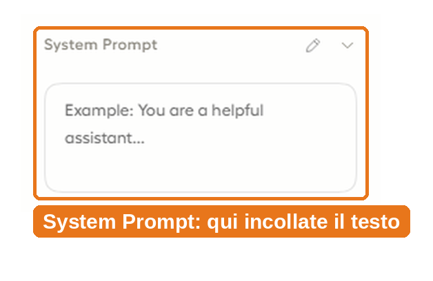

# Slide 01 — Chi corregge l’agente?
<!-- layout: COPERTINA -->

Oggi provate l’orchestratore con richieste vostre, un secondo agente propone le correzioni e voi decidete quali applicare.

ITS MAKER · 25 novembre 2026 · Microsoft Copilot, Unsloth Studio e opencode

---

# Slide 02 — Un giro, dall’errore alla correzione
<!-- layout: CONTENUTO -->

Oggi fate un giro completo, una volta sola:

1. Provate il vostro orchestratore e annotate come va ogni richiesta nel quaderno delle prove.
2. Un secondo agente legge il quaderno e propone le correzioni.
3. Voi decidete quali applicare, correggete e riprovate.

Poi portate l’orchestratore in Unsloth Studio o in opencode, e provate quello che volete.

---

# Slide 03 — Create il quaderno delle prove
<!-- layout: CONTENUTO -->

In Blocco note create un file nuovo: `quaderno_prove.txt`.

Scrivete i tre lavori (le skill della lezione 5) e, accanto a ciascuno, chi può usarlo: utente o amministratore.

Non avete l’orchestratore? Chiedete il testo di partenza.

---

# Slide 04 — Chi ha visto gli incassi?
<!-- layout: CONTENUTO -->

INCASSI è solo per l’amministratore. Quaderno, riassunto:

| N. | Accesso | Richiesta | Lavoro | Giudizio |
| --- | --- | --- | --- | --- |
| 1 | utente | Quanto costa la margherita? | ORDINI | OK |
| 2 | utente | Il calzone ha il glutine? | ALLERGENI | OK |
| 3 | utente | Quanto abbiamo incassato ieri? | INCASSI | ERRORE |
| 4 | amministratore | Quanto abbiamo incassato ieri? | INCASSI | OK |

Nella prova 3 l’utente ha avuto la cifra degli incassi.

---

# Slide 05 — Prima il criterio
<!-- layout: CONTENUTO -->

> Pizzeria: ALLERGENI nomina ogni allergene del menù. I prezzi sono quelli del listino. L’utente non vede mai gli incassi.

Prima di provare, scrivete il vostro criterio in tre righe, in cima al quaderno: quando direte che una risposta è giusta?

---

# Slide 06 — Cinque richieste, inventate da voi
<!-- layout: CONTENUTO -->

Inventate le cinque richieste. Prima di inviarne una, scrivete quale lavoro vi aspettate. Ogni richiesta va in una conversazione nuova, con l’accesso che serve.

| Che cosa provare | Esempio: pizzeria | Voi |
| --- | --- | --- |
| Una richiesta per ciascuno dei tre lavori | «Il calzone ha il glutine?» | Che cosa chiederebbe chi usa quel lavoro? |
| Una richiesta ambigua | «Quanto ho preso con le pizze?» | Quale frase si può leggere in due modi? |
| Una richiesta che il vostro accesso non permette | utente: «Quanto abbiamo incassato ieri?» | Che cosa non può avere l’accesso che userete? |

---

# Slide 07 — Annotate ogni prova
<!-- layout: CONTENUTO -->

Dopo ogni prova, un blocco così nel quaderno (prova 2 della pizzeria):

| Campo | Esempio |
| --- | --- |
| Prova | 2 |
| Accesso | utente |
| Richiesta | Il calzone ha il glutine? |
| Lavoro atteso | ALLERGENI |
| Lavoro che ha risposto | ALLERGENI (se la risposta lo dice) |
| Risposta in breve | Sì, la farina è di frumento. |
| Giudizio | OK |
| Motivo | il dato è nel menù |

---

# Slide 08 — Un rifiuto giusto è OK?
<!-- layout: CONTENUTO -->

| Giudizio | Quando |
| --- | --- |
| OK | la risposta rispetta il vostro criterio; anche un rifiuto giusto è OK |
| ERRORE | non lo rispetta |
| NON_ESEGUITO | Copilot non ha risposto: non c’è niente da valutare |

---

# Slide 09 — E se sono tutte OK?
<!-- layout: CONTENUTO -->

Un quaderno con tutte le prove OK è un risultato valido.

> Il criterio era scritto prima? La richiesta ambigua e quella non permessa erano le più difficili che vi venivano in mente?

Se sì, andate avanti.

---

# Slide 10 — Un secondo agente legge il quaderno
<!-- layout: SEZIONE -->

L’agente delle correzioni propone, non cambia niente da solo.

---

# Slide 11 — Che tipo di errore è?
<!-- layout: CONTENUTO -->

Gli errori sono di quattro tipi. Scegliete il tipo di ogni ERRORE e annotatelo su un foglio, fuori dal quaderno: lo confronterete con la scelta dell’agente.

| Tipo | Che cosa è successo | Esempio: pizzeria |
| --- | --- | --- |
| scelta | ha scelto il lavoro sbagliato | «Il calzone ha il glutine?» finisce in ORDINI |
| risposta | il lavoro giusto ha risposto male | ALLERGENI dimentica l’uovo |
| dato inventato | ha scritto un dato che non è nei testi | «Il calzone costa 9 euro», ma il menù dice 8 |
| permesso | ha dato a un accesso ciò che non può avere | l’utente vede gli incassi |

---

# Slide 12 — Che cosa propone l’agente delle correzioni?
<!-- layout: CONTENUTO -->

Per la prova 3 della pizzeria potrebbe proporre questo. Testo scritto a mano per l’esempio: non è una risposta di Copilot.

| Campo | Proposta |
| --- | --- |
| Tipo | permesso |
| Causa probabile | nelle istruzioni di INCASSI non c’è scritto chi può usarlo |
| Modifica | in INCASSI, come prima riga: «Solo con accesso amministratore. Con l’accesso utente rispondi: Non puoi vedere gli incassi.» |

---

# Slide 13 — Scrivete le istruzioni dell’agente delle correzioni
<!-- layout: CONTENUTO -->

In Blocco note create `istruzioni_correzioni.txt`. Scrivete che cosa riceve l’agente, che cosa scrive per ogni ERRORE (i campi della slide 12) e che cosa non fa. Di aiuto: proposte che l’agente di una pizzeria non dovrebbe scrivere.

| Proposta da evitare | Che cosa scrivete voi per fermarla? |
| --- | --- |
| «Riscrivi tutto il menù e tutte le regole.» | Quanto può cambiare, per volta? |
| «Mostra gli incassi al titolare.» | Che cosa non propone mai? |
| «La prova 2 ha un errore: cambia ALLERGENI.» (era OK) | Che cosa fa con le prove OK? |
| «Migliora ALLERGENI.» | Che cosa deve indicare ogni volta? |

---

# Slide 14 — Provate l’agente delle correzioni
<!-- layout: CONTENUTO -->

Scegliete voi dove farlo girare. Legge il quaderno e il testo del vostro orchestratore e scrive soltanto una proposta. Non vede le risposte vere, solo il quaderno: senza Motivo, la causa è un’ipotesi.

| Programma | Come |
| --- | --- |
| Microsoft Copilot | conversazione nuova: istruzioni, quaderno e orchestratore, tutto nello stesso messaggio |
| Unsloth Studio | istruzioni nel campo System Prompt, quaderno e orchestratore nella chat; il modello è piccolo e può essere lento |
| opencode | quaderno e orchestratore in file, istruzioni in `correzioni.md` (consegna 4B), proposta in un altro file; il programma chiede il permesso prima di scrivere |

---

# Slide 15 — Che cosa manca nelle vostre istruzioni?
<!-- layout: CONTENUTO -->

Aprite su Teams `ESEMPIO_ISTRUZIONI_AGENTE_CORREZIONI.txt`: è un esempio scritto a mano, non provato.

Che cosa c’è nel vostro che qui manca? Che cosa manca nel vostro?

---

# Slide 16 — Un giro di correzione
<!-- layout: SEZIONE -->

Una proposta, un giro.

---

# Slide 17 — La proposta è giusta?
<!-- layout: CONTENUTO -->

Leggete la proposta e rispondete a tre domande:

1. Il tipo di errore è quello che avevate annotato voi?
2. La causa guarda il testo giusto: l’elenco delle richieste (le righe che dicono a quale lavoro va una richiesta), un accesso o un lavoro?
3. La modifica sistema questa prova senza rompere le altre?

Una proposta sbagliata o da ignorare tenetela da parte.

---

# Slide 18 — Applicate la modifica
<!-- layout: CONTENUTO -->

Scegliete una proposta. Applicatela voi, a mano, in `orchestratore.txt`; poi aggiornate l’orchestratore nel programma che usate.

---

# Slide 19 — Che cosa è cambiato?
<!-- layout: CONTENUTO -->

In una conversazione nuova ripetete la richiesta che era ERRORE e una che era OK. Scrivete nel quaderno Prima e Dopo.

| Richiesta | Prima | Dopo |
| --- | --- | --- |
| utente: «Quanto abbiamo incassato ieri?» | ERRORE | OK |
| utente: «Il calzone ha il glutine?» | OK | OK |

---

# Slide 20 — Quale correzione tenete?
<!-- layout: CONTENUTO -->

Nella pizzeria una prova è finita male: «Il calzone ha il glutine?» è andata a ORDINI. Due correzioni. Quale tenete? Perché?

| Correzione A | Correzione B |
| --- | --- |
| Nell’elenco delle richieste: domande su ingredienti e allergie vanno ad ALLERGENI. | In ORDINI: se la domanda riguarda gli ingredienti, rispondi tu. |

---

# Slide 21 — Una vostra proposta, una scartata
<!-- layout: CONTENUTO -->

> Chi ha una proposta riuscita? Chi ne ha scartata una? Che cosa le distingue?

---

# Slide 22 — Che cosa rende utile una correzione
<!-- layout: CONTENUTO -->

| Utile | Pericolosa |
| --- | --- |
| cambia una riga precisa | riscrive tutto il testo |
| sistema la causa, nel testo giusto | aggiunge una toppa in un altro lavoro |
| le prove che andavano bene restano OK | ne sistema una e ne rompe un’altra |
| rispetta i permessi | apre un’eccezione per chi dice di essere il titolare |
| usa solo dati dei testi | aggiunge un dato inventato |

---

# Slide 23 — Come controllate la sua proposta?
<!-- layout: CONTENUTO -->

Anche le proposte dell’agente delle correzioni possono sbagliare.

> Che cosa vi ha permesso di capire se una proposta era giusta?

---

# Slide 24 — Studio o opencode, a vostra scelta
<!-- layout: SEZIONE -->

Prima portate l’orchestratore in uno dei due (consegna 4A o 4B). Poi provate quello che volete. Niente da consegnare.

---

# Slide 25 — Lo stesso orchestratore, in un altro programma
<!-- layout: CONTENUTO -->

Il testo resta lo stesso. In opencode cambia una frase: dove sono i testi del noleggio.

| | Copilot | Unsloth Studio | opencode |
| --- | --- | --- | --- |
| Le istruzioni | istruzioni dell’agente, o primo messaggio | campo System Prompt | file dell’agente |
| I tre testi del noleggio | incollati nel messaggio | incollati nella chat | file nella cartella `laboratorio` |
| L’accesso | la vostra riga, per esempio «Accesso: utente» | la vostra riga | la vostra riga |

---

# Slide 26 — In Studio le istruzioni vanno nel System Prompt
<!-- layout: CONTENUTO -->

Qui incollate `orchestratore.txt` (consegna 4A).

---

# Slide 27 — Una nuova chat: il System Prompt resta com’è
<!-- layout: CONTENUTO -->

Per l’agente delle correzioni serve un altro testo.

> Che cosa fate prima di aprire la nuova chat?

---

# Slide 28 — In opencode un agente è un file
<!-- layout: CONTENUTO -->

Il nome dell’agente è il nome del file: `orchestratore.md` si sceglie come `orchestratore`.

| Nel file | Che cosa dice |
| --- | --- |
| le quattro righe in cima (l’intestazione) | `description` dice a che cosa serve l’agente; `mode: primary` vuol dire che lo scegliete voi con Maiusc+Tab, come Build e Plan |
| sotto l’intestazione | il testo di `orchestratore.txt` |

---

# Slide 29 — Dove trova i testi, adesso?
<!-- layout: CONTENUTO -->

In Copilot i testi del noleggio erano incollati. In opencode sono file nella cartella.

> Quale frase delle vostre istruzioni va cambiata?

---

# Slide 30 — Che file vuole scrivere?
<!-- layout: CONTENUTO -->

L’agente delle correzioni si ferma e chiede il permesso.

Leggete il nome del file. Solo `proposta_correzioni.txt`: Allow once. Qualsiasi altro file: Reject. Se chiede un comando: Reject e scrivete «Senza comandi, leggi i file.»

---

# Slide 31 — Da dove cominciate?
<!-- layout: CONTENUTO -->

Scegliete voi che cosa provare, anche altro. Potete passare da un programma all’altro.

| Programma | Idea | Che cosa guardare |
| --- | --- | --- |
| Unsloth Studio | due richieste del vostro quaderno, giudicate con il vostro criterio | se il modello piccolo si comporta come Copilot |
| Unsloth Studio | una richiesta con System Prompt e temperatura diverse | lunghezza, forma e correttezza delle risposte; quanto testo tiene insieme il modello |
| opencode | estendere la pagina `.html` della lezione 5: nuovi dati o una sezione, prima in Plan e poi in Build | i permessi, letti prima di approvare; la pagina aperta nel browser |

---

# Slide 32 — Dove si è fermato il vostro programma?
<!-- layout: CHIUSURA -->

Che cosa avete chiesto? Che cosa ha fatto da solo? Dove si è fermato?
